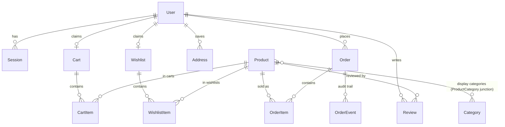

# ElyBeauty — Master Project Architecture Document (PAD) v2.25

**Classification:** Internal Engineering Reference
**Status:** DEFINITIVE, PRODUCTION-LOCKED BLUEPRINT
**Companion Document:** `README.md` (quick start), `AGENTS.md` (agent traps), `CLAUDE.md` (conventions)
**Last Updated:** 2026-11-10

#### Revision Block — v2.25 (Run 98 — the enumeration-lockstep & payment-prose de-drift cycle)

- `[TEST]` **The enumeration-lockstep net (S98-1, audit 98-a D1/D2/D4/N2, TDD — the cycle's centerpiece)**: the docs' route/admin ENUMERATIONS were rotting silently — the count net above pins numbers, not inventories (CLAUDE listed 11-of-13 routes and 8-of-9 admin pages; SKILL §5 listed 10-of-13; AGENTS listed 9-of-13 while its own next sentence said "all 13 route files"). `docs-counts.test.ts` now derives the 13-route inventory from the filesystem (the api-boundaries S91-1 recursive-readdir convention) and the 9-page admin inventory from `src/app/(storefront)/admin` (the dashboard IS the admin root `page.tsx` — no `dashboard/` folder), then set-equals AGENTS's architecture-invariants enumeration, CLAUDE's api + admin enumerations, and SKILL §5's api row against them — a missing OR phantom entry fails by name. RED 7 pins observed → GREEN 14/14. Two lessons encoded: a set-equality pin must use the derivation's own sort (ASCII `-` (45) sorts before `/` (47) — `cart-summary` precedes `cart/bulk`); and `match()` captures are `string | undefined` under `noUncheckedIndexedAccess` — `m?.[1] ?? ""` passes the type gate while the preceding `toBeTruthy()` keeps the failure loud.
- `[DOCS]` **The enumeration + payment-prose sweep (S98-2/S98-3, audit 98-a D1/D2/D3/D4)**: AGENTS's route enumeration → all 13 exact paths (scope honestly widened to "client-island fetches and the Stripe webhook"); CLAUDE's admin list → the 9 pages (the mid-list S19-5 annotation retired from the live-tense inventory); CLAUDE's api list + SKILL §5's row → all 13; CLAUDE's stale "demo payment (no processor)" sentence → the session-61 reality (COD default byte-identical + real Stripe behind keys + `STRIPE_BDT_PER_USD`), with the guard on the non-existent "no real charge" notices removed and the whole class negative-pinned.
- `[DOCS]` **The signpost + pointer + command fixes (S98-4/S98-5/S98-6, audit 98-a D5/D6/N1/N3)**: the SKILL Appendix B session-record signpost "runs 89–96 (v2.17–v2.23)" → "runs 89–97 (v2.17–v2.24)" with run 97 joining the trail; the project_state label "(session 48 cycle)" → "(session 50 cycle)" (the off-by-two run-96 inherited); AGENTS's dangling `docs/session_114.md` pointer (a HomeNest-era file dropped in the run-72 docs reset) → `docs/DEPLOYMENT.md` §4; the AUTH_SECRET generation command single-sourced on `openssl rand -hex 32` (the S97-1 error's own command) across `.env.example` + `DEPLOYMENT.md` ×2.
- `[VERIFY]` **Audit 98-a clean, parity zero-delta on every pinned surface**: 12/12 standing anchors PASS, the run-97 regression surface R1–R8 8/8, 0 CRITICAL/HIGH/MEDIUM — 2 LOW + 2 INFO (6 drift leads CONFIRMED, D7/D8 REFUTED; N4 the `homenest_*` cookie names recorded no-action — documented and deliberate). The untouched-surface scan (csp/proxy/rate-limit/stripe/wishlist/order-status/coupons/settings/cart/admin-payments/analytics/demo-mode/search/health/checkout-success) found zero defects. Gates green (798/798 unit +9 in 68 files, 92/92 e2e ×2, npm audit 0/0, sitemap 28 public-only, robots 4 disallows, .env.example 9/9, 25/25 screenshots). Live parity measured on both sites logged in at 390×844: the panel rows Search/Shop/Beauty Tools/Brush & Combs/About at reference 89/125/161/197/233 vs clone 88/124/160/196/232 (−1px uniform, hrefs AND labels byte-identical), the overlay input Cormorant 18px/300 both, the silk rows byte-identical copies at −1px with $370.00/$288.00/$470.00/$520.00 Cormorant 14px/300 both, /shop 19 cards bonnet-first "All Products" both, the first-card detail ৳370 Inter 24px/600 with both purchase buttons active — and the mobile nav fully functional on both sites (no Tailwind v4 bug).

#### Revision Block — v2.24 (Run 97 — the auth-secret hardening & doc-de-drift completion cycle)

- `[SECURITY]` **The AUTH_SECRET minimum-length floor (S97-1, audit 97-a N1, TDD)**: `assertAuthSecret` rejected only missing/empty/whitespace/dev-fallback — a 1-character non-fallback secret passed the production gate and then keyed the session-cookie HMAC and the order-access tokens. The gate now enforces `MIN_AUTH_SECRET_LENGTH = 32` (the README's documented `openssl rand -hex 32` guidance), with the error message naming the floor and the command. RED 3 pins in `auth-secret.test.ts` (1-char and 31-char reject; 32-char passes) → GREEN 8/8; the pre-existing "strong secret" fixture (31 chars) updated to the new contract.
- `[SEO]` **The productMetaDescription whitespace hardening (S97-3, audit 97-a N6, TDD)**: a whitespace-only field is truthy in the bare `||` chain and would ship as the meta (defended upstream by the schema's `.trim()`, but the helper owns the never-empty invariant). Each term now trims before the fallthrough. RED 2 pins in `seo-ld.test.ts` → GREEN 21/21.
- `[TEST]` **The lockstep net extended + the accent pin hardened (S97-2 + S97-4, audit 97-a N4/N5, TDD)**: `docs-counts.test.ts` now pins README's model-count sites (the architecture table + the file-hierarchy tree to 20 models; "19 models" fails the gate BY NAME — the drift class S95-4 was built to catch had rotted README silently); the S96-2 accent pin moved from a count heuristic to per-tag assertions (every `<input type="checkbox">` tag carries `accent-foreground`), with the regex lesson encoded: an `onChange` arrow contains `>`, so a `[^>]*` pattern truncates mid-tag and misses a `className` that follows the handler — the tag match spans to the self-closing slash. Mutation-verified: stripping the class from a checkbox fails the pin by name.
- `[DOCS]` **The stack-table + anatomy de-drift (S97-5 + S97-6, audit 97-a D15/N2/D9/D14)**: PAD §1.2's Radix row → the installed set (dialog, label, select, slot, toast — the sheet/tabs/radio claims were scaffold-era); SKILL §5's ui-primitives example list → the actual 9-file inventory (badge, button, dialog, input, label, select, textarea, toast-primitives, toaster); README's primitives row drops "sheets"; SKILL §1's rule-1 radius pins → the measured scale (xl 8px · 2xl 12px · 3xl 16px — the §19 table is authoritative; §1 had carried homenest-era values); rule 2's mobile-menu anatomy → the S74-2/S73-4 reality (SEARCH + 4 links, no in-panel close button, `aria-current` only — no visible active pill); §19's green-close-button note corrected (the header family's only `rounded-full bg-primary` is the cart-count badge).
- `[DOCS]` **The SKILL §2/§3/§6/§8.3 de-drift (S97-7, audit 97-a D10–D13)**: §6's store field list → `searchOverlayOpen` (the S8-11 rename the doc missed); §8.3's limiter grid completed with the measured inventory (changePassword 10/min/email + 30/min/IP; the review two-tier — per-IP 20/min ceiling above the per-author 5/min; cart/bulk 10/min; cart-summary 120/min; addresses 60/min ×3 methods; stripe/payment-intent 10 per 10 min keyed user-or-IP); §2's broken "(§10.4)" cross-ref → §9.3; §3's script table gains the `typecheck:tests` row (part of the gate chain since session 4).
- `[DOCS]` **The PAD body de-drift (S97-8, audit 97-a D2–D7 + N3)**: §4.1's ER mermaid gains the `ProductCategory` junction edge (`Product }o--o{ Category`) and the non-relational list gains `StripeEvent` — the diagram + list now account for all 20 models the heading claims; §1.4's "Curated for You" row → the 19-product 1:1 mirror (the "13 more products superset" was pre-run-81 residue) and the checkout row → the guest-checkout reality (the reference supports guest checkout per ADR-004 + the live dossier; the clone's superset is coupons + in-tx total re-derivation); §6's "the sole `$queryRaw`" → the two measured sites, "sequential numbers" → crypto-random order numbers; §8.2's storefront row → the one-page 24-per-page grid; §2's topology → all 13 route files (cart/bulk + the two stripe routes joined).
- `[VERIFY]` **Audit 97-a clean, parity zero-delta on every pinned surface**: 12/12 standing anchors PASS, the run-96 regression surface R1–R8 8/8, 0 CRITICAL/HIGH/MEDIUM — 18 LOW + 3 INFO (14 drift leads CONFIRMED, D8 refuted — the PAD §5 radius claim is accurate as written; N7 the overlay's in-flight empty-state flash recorded no-action — a cosmetic micro-state whose reference behavior is unmeasured). Gates green (789/789 unit +5 in 68 files, 92/92 e2e ×2, npm audit 0/0, sitemap 28 public-only, robots 4 disallows, .env.example 9/9, 25/25 screenshots). Live parity measured on both sites logged in at 390×844: the panel rows Search/Shop/Beauty Tools/Brush & Combs/About at reference 89/125/161/197/233 vs clone 88/124/160/196/232 (−1px uniform, hrefs AND labels byte-identical), the overlay input Cormorant 18px/300 both, the silk rows byte-identical copies at −1px with $370.00/$288.00/$470.00/$520.00 Cormorant 14px/300 both, /shop 19 cards bonnet-first "All Products" both, the first-card detail ৳370 Inter 24px/600 with both purchase buttons active — and the mobile nav fully functional on both sites (no Tailwind v4 bug).

#### Revision Block — v2.23 (Run 96 — the SEO-fallback completion & full-stack doc-de-drift cycle)

- `[SEO]` **The product meta-description fallback chain completed (S96-1, audit 96-a L-8)**: the run-95 content resync (S95-2) left `natural-bamboo-hair-brush-oval` with BOTH `shortDescription` and `description` empty — the detail page's two-term S76-8 chain (`shortDescription || description`) then shipped an EMPTY meta/OG/Twitter/JSON-LD description, exhausting the "never an empty-string meta" invariant. Reference-side investigation: the reference itself ships a GENERIC meta ("Product Detail on ElyBeauty. A high-fashion…") on every product page — the clone's per-product metas are the deliberate SEO superset, so the fix restores the invariant with a name-based third term rather than regressing to the generic. NEW shared `productMetaDescription()` in `src/lib/seo.ts` (shortDescription → description → `` `${name} — ElyBeauty` ``), consumed by BOTH the detail page's `generateMetadata` AND `buildProductJsonLd`; the S76-8 comment rewritten to the three-term chain. RED 5 pins → GREEN; live-verified on the standalone server (the oval's meta/og/twitter/JSON-LD descriptions all read "Natural Bamboo Hair Brush - Oval — ElyBeauty").
- `[UI]` **The admin accent-color reskin completion (S96-2, audit 96-a L-10)**: six admin-dialog checkboxes still hardcoded the pre-re-skin terracotta `accent-[hsl(24_70%_50%)]` (product-dialog ×3 — active/featured/newArrival — slide-dialog, category-dialog, coupon-dialog) vs the token palette's `accent-foreground` (which product-dialog's own category checkbox already used — the dialogs were inconsistent even internally). All six now ride `accent-foreground`, pinned by the S96-2 source-scan describes in `layout-tokens.test.ts` (the L-1/L-2 no-#d96e26 precedent extended to the accent utilities). RED 2 → GREEN 77/77.
- `[DOCS]` **The search-contract text de-drift (S96-3/S96-4, audit 96-a L-1/L-2/L-9)**: three S77-era texts still described the typeahead as matching the LONG description, contradicting the S95-1 code + line-110 contract — `CLAUDE.md`'s overlay paragraph, `AGENTS.md`'s S77 trap-log sentence (both live-tense agent-guidance), and `search-overlay.tsx`'s own header comment (the only `long description` remnant in src/). All three now carry the S95-1 measured contract (name + shortDescription + tags ONLY, case-insensitive — description-only words return ZERO rows on the reference) with the why (the owner moved the marketing copy into short_description at run-95).
- `[DOCS]` **The catalog gloss + PAD §4.3/§8.2 de-drift (S96-5/S96-7, audit 96-a L-3/L-5/L-6)**: `CLAUDE.md`'s seed-catalog gloss still read "16 products / 3 cookware / 8 categories" (the homenest era) — now 19 products / 4 display categories / the 7-3-4 dual memberships. PAD §4.3's three stale claims fixed (memberships "10/6/3" → the measured 7/3/4; "full description/how-to-use/ingredients copy" → the run-95 content reality; "sold-out pieces visible" → the S90-4 all-positive stock). PAD §8.2's globalSetup description corrected to the implemented mechanism (TCP-probe :3100 → run the idempotent restore-demo-stock when a server is already listening; it never restarts or build-compares anything).
- `[DOCS]` **The SKILL §19/§2/§5 resync + the session-record boundary (S96-6/S96-8, audit 96-a L-4/L-7 + I-1/I-4)**: §19's entire Color Reference table was the pre-re-skin terracotta palette while claiming "all values exact" — rebuilt from the live `globals.css` (taupe `hsl(30 12% 48%)` primary, ivory `hsl(30 20% 97%)` bg, radius sm 2px→3xl 16px, the success/badge tokens). §2's table gains the Stripe packages row (stripe ^23.0.0 + the two SDKs — covered in §7.4 prose but absent from the table). §5's reproducible counts refreshed (127 → 144 tracked TS files; 13+9 → 15+10 components; 38 → 41 use-client files — each re-derived with the documented commands). A session-record boundary note added after Session 88's entry: runs 89+ live in the PAD revision blocks + REMEDIATION_PLAN + the session_NN.md logs (the signpost, with the era-accurate historical entries deliberately untouched).
- `[VERIFY]` **Audit 96-a clean, parity zero-delta on every pinned surface**: 12/12 standing anchors PASS, the run-95 regression surface R1–R7 7/7, 0 CRITICAL/HIGH/MEDIUM — 10 LOW + 6 INFO (all substantive LOW remediated; I-2 the howToUse/ingredients admin-editing gap recorded as a deferred enhancement — seed-only content, preserved by upserts; I-3 the replay-branch attribution nuance — the invariant held; the menu button's state-dependent aria-label recorded as the documented a11y-superset tolerance). Gates green (784/784 unit +7 in 68 files, 92/92 e2e ×2 consecutive (2.5m + 2.4m), npm audit 0/0, sitemap 28 public-only, robots 4 disallows, .env.example 9/9, 25/25 screenshots — 6 changed, the known raster-noise/data-dependent family); live parity measured on both sites logged in at 390×844: the panel rows Shop/Beauty Tools/Brush & Combs/About at reference 125/161/197/233 vs clone 124/160/196/232 (−1px uniform, hrefs AND labels byte-identical), the overlay input Cormorant 18px/300 with "Search products..." both, the silk rows 174/258/342/426 vs 173/257/341/425 (h=80) with all four copies BYTE-IDENTICAL and $370.00/$288.00/$470.00/$520.00 at Cormorant 14px/300 both, /shop 19 cards bonnet-first h1 "All Products" both, the bonnet detail ৳370 Inter 24px/600 with both buttons active — and the mobile nav fully functional (the panel → overlay → results → navigation chain exercised live on both sites; zero `classList` in src/, the conditional-mount pattern holding — no Tailwind v4 bug).

#### Revision Block — v2.22 (Run 95 — the reference-content resync & PAD-body de-drift cycle)

- `[API]` **The search matching resynced to the reference's run-95 measured behavior (S95-1)**: `/api/search`'s OR clause drops the S77-4 `description` term — the reference's overlay matches **title + short_description + tags only** (measured live: "Silkfare" and "Nano" — words that appear only in descriptions — return ZERO rows on the reference, while "spa-like" (short_description) and "bastseller" (tag) match; "SILK" → 4, case-insensitive). The S77-4 clause was measured against the reference's THEN-content (the paragraphs lived in `description`); the owner has since moved them to `short_description`, and the clause would now over-match the resynced content. Pinned by the rewritten OR-clause pin in `search-route.test.ts`.
- `[DATA]` **The seed content resync (S95-2 — the reference's owner restructured the catalog since run-77)**: the marketing paragraphs now live in `short_description` (13/19 products; null for 6 — the card/overlay desc line renders only when present), `description` holds feature lists or nothing (3 nulls — the detail page's Description section is now CONDITIONAL like How to Use/Ingredients, and the whole sections block hides when no field carries copy), `how_to_use` is empty reference-wide (the run-72-authored usage copy removed), `ingredients` exists only on the Ice Bowl, and the authored quirks are verbatim per the S74-13 convention (Bonnet tag "bastseller", sizes "Pink & Lovender"/"Marron & Navy Blue", the massager color "Biege", the Curler's "Navy blue"). Pinned +4 in `seed-catalog.test.ts` + the storefront e2e usage-section pin flipped to the no-section reality.
- `[DOCS]` **The PAD live-tense body de-drift (S95-3, audit 95-a L-1..L-5)**: the body had frozen around the run-76/80 era — §1.2 stack table (737/90), §8.1 heading (634) + a 48-of-67 file table carrying "12-per-page pagination" and `/products?q=`, §8.2 (79 tests, "Two projects", "order numbers increment", no globalSetup-heal/password-change rows), §3.1/§4.1/§12 ("19 models" ×3), §12 (634/82) — while only the append-only revision blocks ever carried the current numbers. All refreshed: the counts (774/92), the 20 models, the three-project e2e reality (70 desktop + 10 mobile + 12 serialized admin-catalog), the S84-2 globalSetup heal, the S92-2f password-change spec row, crypto-random order numbers, 24/page one-page grid, `/shop?q=`, and the §8.1 table extended to all 68 suites.
- `[TEST]` **The count-lockstep pin (S95-4 — the neo-crm mechanism, web-application skill §14)**: NEW `tests/unit/docs-counts.test.ts` puts every live-tense count site (README badge/table/tree/commands, CLAUDE testing line, PAD §1.2/§8.1/§8.2/§12, SKILL project_state + §2) under the unit gate — a stale count anywhere fails the suite BY NAME, so the docs sweep can no longer be forgotten when a count changes. RED 5/5 against the frozen PAD → GREEN after the de-drift.
- `[DOCS]` **The advisory inventory + cosmetics (S95-5/S95-6, audit 95-a L-6 + I-1/I-2)**: `admin-password-advisory.ts`'s header names the four actual doc sites (AGENTS/README/PAD/SKILL — the S94-6 lockstep inventory; `.env.example` deliberately clean), pinned by a source scan in `admin-password-advisory.test.ts`; the auth.spec header comment no longer re-inlines the credential pair; the capture script's "sequential" order-number wording corrected to crypto-random.
- `[VERIFY]` **Audit 95-a clean, parity zero-geometry-delta + the content resync**: 12/12 standing anchors PASS, the run-94 regression surface R1–R5 5/5, 0 CRITICAL/HIGH/MEDIUM — 6 LOW + 5 INFO (all LOW remediated; I-3 dependency posture, I-4 import nuance, I-5 no-count-row recorded no-action; P-4 the reference's ৳11 compare-price data noise recorded, not replicated). Gates green (777/777 unit +13 in 68 files, 92/92 e2e ×2 consecutive, npm audit 0/0, sitemap 28 public-only, .env.example 9/9, 25/25 screenshots); live parity within the recorded tolerances on both sites logged in, and the overlay rows + card desc lines now byte-match the reference's resynced copy (the "silk" set's desc lines, prices, and fonts identical; the search behavior verified equal on "silk"/"Silkfare"/"bastseller"/"spa-like"); mobile nav fully functional — no Tailwind v4 bug.

#### Revision Block — v2.21 (Run 94 — the Stripe-replay ownership & SKILL-body de-drift cycle)

- `[API]` **The Stripe-intent replay is ownership-bound (S94-2, audit 94-a L-7)**: `placeOrderWithRetry`'s `stripePaymentIntentId` P2002 branch returned the already-placed order's receipt UNCONDITIONALLY — `if (existing) return existing.number` — while the idempotencyKey sibling routes through `resolveReplay` (S7-2) precisely because a caller who merely KNOWS another client's anchor must not receive the winner's `{orderNumber, token}` (the receipt capability: name/address/items PII). A leaked `pi_…` id plus a cart passing the pre-tx amount verification would have handed the receipt over. The branch now routes through the same `resolveReplay(existing, args.userId, args.cartToken)` gate with the 409 replay-denied mapping; the webhook backstop places with the SAME userId/cartToken metadata (extracted from the intent's metadata), so a genuine double-submit still replays. Pinned +3 in `tests/unit/checkout-stripe-replay.test.ts` (the api-boundaries route-import conventions: the deny pin, the genuine-retry pin, and the source-composition pin).
- `[AUTH]` **The scrypt hash leaves the transaction (S94-4, audit 94-a I-1)**: `scryptHash(parsed.data.newPassword)` was evaluated INSIDE the `$transaction` callback — the synchronous ~30–80 ms burn ran while the SQLite write lock was held, widening the lock window for every concurrent writer. The hash is a pure function of the parsed input: now computed BEFORE the transaction opens and passed in (zero behavior change, shorter lock hold). Pinned by the source pin in `credential-rotation.test.ts`.
- `[TEST]` **The e2e bundle guard joins the credential single-source (S94-1, audit 94-a L-6)**: `tests/e2e/auth.spec.ts`'s S13-1 guard hardcoded both demo password literals — a future credential rotation would leave it asserting the OLD strings (vacuously green) while a leak of the NEW password into a client chunk went undetected. The guard now imports `DEMO_ADMIN_PASSWORD`/`DEMO_CUSTOMER_PASSWORD` from `src/lib/demo-credentials` (the helpers.ts pattern), pinned by two new source-scan describes in `e2e-infrastructure.test.ts` (the import shape + zero literals across every e2e spec).
- `[DOCS]` **The SKILL body de-drift pass (S94-3/S94-5, audit 94-a L-1..L-5 + I-2)**: five live-tense drifts CONFIRMED and fixed in `ely-beauty_SKILL.md` — §1 still read "HomeNest Kitchen / nest-culinary-hub.base44.app / kitchenware aesthetic / Playfair / 8 category tiles" (stale since the run-72 re-skin) and pinned the primary to the pre-re-skin terracotta `hsl(24 70% 50%)`; §2's version table carried `prisma ^6.11.1` / `vitest ^3.2.4`, an uninstalled radix set (radio-group, tabs), and "Playfair Display"; §7.1 said "18 models" (the schema declares 20 — `ProductCategory` + `StripeEvent` omitted) and "ORD-YYYY-NNN sequential" (actual `ELY-XXXXXXXX` crypto-random); §8.3 described clientIp as the XFF "first hop" (actual: `cf-connecting-ip` → RIGHTMOST XFF → direct, with the `TRUST_CF_CONNECTING_IP` opt-out); §11's checklist repeated the ORD format; the §6 directory table said "18 models"; the session-132 key-files list still pointed at `capture-screenshots.mjs`. CLAUDE.md's one stale `.mjs` mention updated. Historical session narrative left untouched (accurate for their eras). `demo-credentials.ts`'s lockstep inventory corrected (S94-6: PAD added, `.env.example` removed — it deliberately does not document the pair).
- `[VERIFY]` **Audit 94-a clean, parity zero-delta**: 12/12 standing anchors PASS, the run-93 regression surface R1–R5 5/5, 0 CRITICAL/HIGH/MEDIUM — 7 LOW + 5 INFO (all LOW remediated; I-4 cookie names + I-5 allowScripts recorded no-action). Gates green (764/764 unit +6, 92/92 e2e ×2 consecutive, npm audit 0/0, sitemap 28 public-only, .env.example 9/9, 25/25 screenshots); live parity within the recorded tolerances on both sites logged in (panel reference 89/125/161/197/233 vs clone 88/124/160/−/− −1px uniform with byte-identical hrefs in this environment's coordinates; overlay input Cormorant 18px/300 + 0.6-alpha both; the silk set reference 174/258/342/426 vs clone 173/257/341/425 −1px ×4 with $-format prices byte-identical; /shop 19 bonnet-first "All Products" both; detail ৳370 Inter 24px/600 with both purchase buttons active; mobile nav fully functional — no Tailwind v4 bug).

#### Revision Block — v2.20 (Run 93 — the rotation-atomicity & credential-single-sourcing cycle)

- `[AUTH]` **The transactional credential rotation (S93-1, audit 93-a MEDIUM-1)**: `changePasswordAction`'s rotation was three independent awaited writes (`user.update` → `session.deleteMany` → `createSession`) — a crash or SQLite write-lock timeout between the first two left the password CHANGED while every pre-change session stayed alive (the exact threat the rotation exists to kill) for up to the 30-day TTL, with no forgot-password recovery. The hash write and the session kill now run inside ONE `db.$transaction` via the new `rotateCredentialInTx` seam (`src/lib/credential-rotation.ts`, the `growReviewAggregate` S13-4 convention — structural client, caller-owned boundary); `createSession` stays after the commit (its row + cookie are not transactional; a failure there is a benign full sign-out). Pinned +6 (3 seam + 3 action-source pins — the api-boundaries file-reading convention).
- `[AUTH]` **The advisory's TTL-cached negative verdict (S93-4, audit 93-a LOW-3)**: the S92-2e detector burned a synchronous scrypt (~30–80 ms event-loop stall) on EVERY production dashboard render — including the post-rotation steady state. A NEGATIVE verdict is now cached for 60 s (module state, `resetAdvisoryCacheForTests()` seam); a POSITIVE verdict is never cached, so the advisory clears on the very first render after the password rotates. Pinned +3 (cached-within-TTL, re-check-after-TTL, positive-never-cached).
- `[TOOLING]` **`scripts/capture-screenshots.mjs` → `.ts` (S93-2, audit 93-a LOW-1)**: the screenshot pipeline was the last consumer hardcoding both demo credential pairs. Now TypeScript (`npx tsx scripts/capture-screenshots.ts`, the `restore-demo-stock.ts` pattern — the body lives in an async `main()` because tsx compiles the file as CommonJS: the repo's package.json carries no `"type": "module"` and top-level await is a CJS syntax error), importing `src/lib/demo-credentials.ts` at every login site, the checkout contact fill, and the track-order URL (`encodeURIComponent`). Invocation references updated in AGENTS/README/SKILL/DEPLOYMENT; `typecheck:tests` covers the file.
- `[DOCS]` **The SKILL's pre-rename demo-email drift (S93-3, audit 93-a LOW-2)**: `ely-beauty_SKILL.md`'s demo-account table still carried `@homenestkitchen.com` (stale since the run-72 re-skin) — now `@elybeauty.com`, with the module's lockstep list extended to the SKILL.
- `[VERIFY]` **Audit 93-a clean, parity zero-delta**: 12/12 standing anchors PASS, the run-92 regression surface R1–R8 8/8, 0 CRITICAL — 1 MEDIUM + 3 LOW + 4 INFO (all substantive findings remediated; the INFO recorded: no-JS account-form GET fallback matches the ProfileForm pattern, same-password rotation allowed, scheme-less site URL fails fast). Gates green (758/758 unit +9, 92/92 e2e ×2 consecutive, npm audit 0/0, sitemap 28 public-only, .env.example 9/9); live parity within the recorded tolerances (panel reference 99/135/171/207/243 vs clone 98/134/170/206/242 −1px uniform with byte-identical hrefs; overlay input Cormorant 18px/300 + 0.6-alpha both; the silk set −1px ×4 with $-format prices byte-identical; /shop 19 bonnet-first "All Products" both; detail ৳370 Inter 24px/600 both; mobile nav fully functional — no Tailwind v4 bug). The session-43 orphan-`next-server` trap recurred at the clone-side parity pass (resolved by the PID-kill ritual before any capture).

#### Revision Block — v2.19 (Run 92 — the production-deploy hardening cycle, the operator's jesspete.shop signal)

- `[SIGNAL]` **The operator deployed to production at `https://ely-beauty.jesspete.shop`** (`docs/start_server_log.txt`): custom `NEXT_PUBLIC_SITE_URL` + a real `AUTH_SECRET`; db:setup → build (11/11 static) → standalone start, all green in the field. The deployed site verified live from the sandbox: health `db:up`, sitemap **28 locs on the custom domain**, robots, canonical + og:url, JSON-LD, the full security-header set (per-request CSP nonce, HSTS, Permissions-Policy, X-Frame-Options DENY, nosniff, referrer).
- `[AUTH]` **The password-change surface + default-credential advisory (S92-2, audit 92-a HIGH-1 — the cycle's centerpiece)**: the app had NO password-change path anywhere (updateProfileAction covered name/phone only), so a production deploy seeded with the demo admin had no UI remediation. Added: `changePasswordSchema` (validation.ts, the new password rides the register `passwordSchema`); `changePasswordAction` (session-required, per-email + per-IP rate budgets, current-password verify with a uniform inline error, scrypt re-hash, **every session row deleted then a fresh one issued — the rotation signs out all other devices**); the `PasswordForm` island on the account Profile tab; `src/lib/demo-credentials.ts` (the seeded credentials single-sourced across the login quick-fill, the seed, and the advisory — was three copies); `isDefaultAdminPasswordActive()` (`src/lib/admin-password-advisory.ts`) powering the admin-dashboard `role="alert"` **Default admin password active** card (production posture only — `!demoModeEnabled()`), linking to `/account?tab=profile`. E2e: the round-trip spec (old password stops authenticating, new works, wrong-current error, seed restored + self-heal) runs SERIALIZED in the admin-catalog project (the S83-1 pattern extended to a password mutation — S92-2f), and the advisory is asserted on the production-posture e2e server. Unit 738 → 749 (+11: 5 advisory + 4 schema + 2 siteBaseUrl), e2e 90 → 92.
- `[SEO]` **`siteBaseUrl()` whitespace hardening (S92-1, audit LOW-1)**: a whitespace-only `NEXT_PUBLIC_SITE_URL` was truthy — every page 500'd at `new URL()` while the baked sitemap emitted broken origins. The value now trims before the fallback decision (the db-path convention), pinned in seo-ld.test.ts.
- `[DOCS]` **DEPLOYMENT.md §6 — the custom-domain production deploy walkthrough (S92-3, audits MEDIUM-1 + LOW-2)**: the operator's verified workflow (domain → env → db:setup → build → start → rotate the admin password → verify), the **baked-sitemap trap** callout (sitemap/robots prerender at build time — editing the site URL without a rebuild diverges them from the per-request canonicals), and the `TRUST_CF_CONNECTING_IP` edge-topology decision (trust behind Cloudflare; `"false"` on direct deploys — the client-forgeable header must not mint per-IP limiter buckets).
- `[VERIFY]` **Audit 92-a clean, parity zero-delta**: 12/12 standing anchors PASS, the run-91 force-dynamic surface 13/13, 0 CRITICAL; gates green (749/749 unit, 92/92 e2e ×2 consecutive, npm audit 0/0, sitemap 28 public-only, .env.example 9/9); live parity byte-consistent (panel 99/135/171/207/243 IDENTICAL on both sites this environment — the historical −1px was cross-environment rounding; overlay/silk/shop/detail pins within tolerance). The session-43 orphan-`next-server` trap recurred live during the screenshot pass (the stale port owner served wiped chunks; `pkill -f standalone/server.js` misses the renamed `next-server (vNN)` child) — resolved by PID kill per the documented ritual.

#### Revision Block — v2.18 (Run 91 — the API force-dynamic consistency & verification cycle)

- `[API]` **Every API route file declares `export const dynamic = "force-dynamic"` (S91-1, audit 91-a INFO-1)**: 11 of 13 route files carried no explicit rendering-mode declaration (only the two Stripe routes did). Zero behavioral impact today — Next 15+/16 leaves request-reading handlers uncached by default — but the family SKILL §6 idiom is the explicit declaration, and a future edit that stops reading the request (e.g. a parameterless GET) would silently become static-cached without it. TDD: the source-scan pin in `tests/unit/api-boundaries.test.ts` (RED 11/13 → GREEN file-wide, all 13 routes); the convention recorded in AGENTS.md. Unit count 737 → 738.
- `[VERIFY]` **The operator's named surfaces verified live this cycle**: the DATABASE_URL contract (`.env` = `file:../db/custom.db`, `db/` at the repo root, the db-path seam resolving one file for CLI/dev/build/standalone; audit A1 PASS); the mobile navigation (Tailwind v4 trap scan clean — zero JS-toggled display utilities, the conditional-mount pattern holding; live parity panel −1px uniform, hrefs byte-identical; the mobile-navigation e2e spec green ×2); the Vitest + Playwright suites (737→738 unit / 90 e2e ×2 consecutive); the sitemap + SEO surface (28 public-only locs, robots, noindex ×10, canonicals, escaped JSON-LD). Zero new parity deltas on the live reference (panel, overlay "silk" set −1px ×4, /shop 19 bonnet-first "All Products", detail ৳370 Inter 24px/600 with the S90-4 restock holding).

#### Revision Block — v2.17 (Run 90 — the coupon-label format & README-table drift cycle)

- `[MONEY]` **The coupon min-subtotal label rides `formatMoney` (S90-2, audit 90-a
  F-3 upgraded)**: the hand-built `Number.isInteger`/`toFixed` label in
  `couponDiscount` rendered "৳1000" without comma grouping — a live divergence on
  the seeded SAVE20 path (minSubtotal 100000 = ৳1,000) against the comma-grouped
  convention every other money surface uses. The label now builds from
  `formatMoney(coupon.minSubtotal)` (৳1,000 / ৳365.50); pinned by the comma-grouping
  + poisha cases in `tests/unit/coupons.test.ts` (RED → GREEN, +1 pin).
- `[DOCS]` **The README architecture-table drift (S90-1, audit 90-a F-1)**: the
  Prisma/Zod/Vitest version cells corrected to the actual declared ranges
  (^6.19 / ^4.6 / ^4.1 — stale since runs 86/88); the CLAUDE/README count rows
  swept 735 → 736.
- `[TESTS]` **The S88-1 comment precision (S90-3, audit 90-a F-4)**: the
  session17-hardening comment now states vitest 4.1.12's actual declaration —
  `fn<T extends Procedure | Constructable = Procedure>` (constraint vs default) —
  the operative typed-mock conclusion unchanged.
- `[CATALOG]` **The run-90 restock (S90-4, discovered mid-cycle at the live parity
  pass)**: the reference restocked the four run-72 stock-0 products (verified live:
  active purchase panels on all four of its detail pages); the seed mirrors with
  positive stock file-wide (25/30/20/15 — the reference exposes no numbers; the
  visible contract is "purchasable"), applied via `restore-demo-stock.ts` (the S7-3
  traffic-owned policy — `db:setup` alone never touches stock), the stale sold-out
  comments re-recorded, and the out-of-stock rendering path retained for genuinely
  drained rows. Pinned by the S90-4 restock pin in `seed-catalog.test.ts`
  (RED → GREEN).

#### Revision Block — v2.16 (Run 88 — the npm-audit retirement cycle)

- `[TOOLCHAIN]` **The npm-audit zero (S88-1..S88-4, the operator's `docs/start_server_log.txt`)**:
  the run-86-recorded "accepted dev-only families" retired — vitest 3.2.7 →
  4.1.12 (the two critical tinypool RCE gadgets and the two @vitest/mocker
  moderates gone; vitest 4 drops tinypool entirely and carries the patched
  mocker 4.1.12), the scoped npm overrides
  `@typescript-eslint/typescript-estree → minimatch ^11.0.5` and
  `@prisma/config → deepmerge-ts ^8.0.2` (the two advisories whose upstream
  fix has not propagated), and the prisma CLI ↔ client skew aligned at
  ^6.19.3 (the operator-log "Generated Prisma Client (v6.12.0)" signal).
  `npm audit` = 0 vulnerabilities. All floors pinned by
  `tests/unit/toolchain-versions.test.ts` (10 pins, lockfile-read); the one
  source fix: vitest 4's `vi.fn()` typing in `session17-hardening.test.ts`
  (mocks now typed to the seam's exact function signatures).

#### Revision Block — v2.15 (Run 87 — the lost-config build-resilience cycle)

- `[BE]` **The build-anywhere resilience contract (S87-1..S87-3, the operator's
  `docs/build_error.txt`)**: the operator's checkout lost `tsconfig.json` +
  `postcss.config.mjs` (the only build-critical root configs untouched since
  the 2026-10-12 initial migration) and `npm run build` died with 312
  module-not-found errors + 15 @apply/@utility warnings — reproduced
  signature-for-signature on a local tree minus both files. Three layers now
  hold: `turbopack.resolveAlias` carries the `@/*` alias in `next.config.ts`
  itself; `scripts/ensure-build-configs.mjs` (the CONFIG_FALLBACKS registry —
  write-if-missing-or-empty, never overwrites) restores the five
  long-untouched configs; the seven gated npm scripts chain the bootstrap
  first. Pinned by `tests/unit/build-config-resilience.test.ts` (717 → 725
  unit). Acceptance: 4/4 poison-tree builds green (fresh install, each config
  deleted, the operator's exact both-missing tree), the restored tsconfig
  byte-identical, the standalone CSS carrying compiled `@apply` output.

#### Revision Block — v2.14 (Run 86 — the zod 3→4 migration cycle)

- `[BE]` **zod ^3.25.76 → ^4.6.7** (S86-1, audit 86-a H-1): the standing
  deferred debt retired, driven by the unpatchable HIGH advisory
  GHSA-mrhx-c7xc-m3w5 (memory exhaustion validating oversized constrained
  collections — fixed only in ≥4.6.7; v3 is end-of-line). The census's
  one hard break — `stripe-payment.ts`'s single-arg `z.record(z.string())`
  (constructs silently, then throws `TypeError` at parse in the v4
  preview; 4.6.7 keeps it only as deprecated v3-compat) — fixed to the
  two-arg `z.record(z.string(), z.string())` with the exact
  `Record<string, string>` semantics, unit-pinned by the first
  webhook-metadata test. A v4 sentinel pin (`typeof z.email ===
  "function"`) locks the runtime against a silent v3 re-resolve.
- `[BE]` **The deprecated-but-functional v4 usages modernized** (S86-2):
  `emailSchema` restructured to the v4 pipe idiom
  (`.pipe(z.email(…))` — probe-verified message-identical across the
  full battery), `z.ZodIssueCode.custom` → `"custom"` ×3, and the
  `{ message: }` refine/enum params → `{ error: }` ×3. The un-messaged
  checks' v4 default texts are ACCEPTED by policy (documented in the
  plan: both v3/v4 defaults are technical zod-speak, 11 form files carry
  client maxLength caps, zero test pins exist).
- `[FE]` **The placeholder-localization sweep** (S86-4/S86-6, audit L-1 +
  I-1/I-2): the HomeNest kitchenware trio on the skincare admin dialog
  (dutch-oven slug / HN-DUTCH-24 SKU / "Capacity: 6 qt" specs) → the
  store's own conventions (`rosehip-glow-serum` / `ELY-020` / bamboo
  spec lines); the account phone placeholder `+1 (555) 000-0000` → the
  codebase's BD `+880 1712 345678`; the order dialog's UPS/FedEx/USPS +
  1Z… placeholders → `Pathao, RedX, Sundarban…` + a format-neutral
  tracking dummy.
- `[BE]` **Dead exports removed** (S86-5, audit L-2): `stripePublishableKey()`
  (zero consumers — the checkout page resolves via `resolveStripeConfig`
  directly) and `ROLES` (zero consumers).
- `[TE]` Suite: 708 → **717 unit** (+9: the v4 sentinel, the email battery,
  the coupon-enum message, the settings-refine messages, the superRefine
  custom-code pins, the webhook-metadata record pin, and the three
  placeholder pins); 90/90 e2e ×2 consecutive on the migrated tree; the
  zod advisory GONE from `npm audit` (the remaining 11 are the accepted
  dev-only families — vitest/tinypool + the eslint toolchain).

#### Revision Block — v2.13 (Run 85 — the admin taka-copy completion & comment-scope cycle)

- `[FE]` **The admin dialogs' money copy reads taka end-to-end** (S85-1/
  S85-2, audit 85-a L-1): the product dialog's two field labels (Price /
  Compare-at) and both parse errors, plus the settings form's threshold
  error and its three "Enter taka (৳)." helpers, now carry the store's
  currency — the residue the run-84 S84-4b sweep missed (it fixed only
  the coupon dialog). The settings doc comment now describes the
  taka ⇄ poisha edit (the `*Dollars` field names are recorded as
  HomeNest-scaffold heritage, internal only).
- `[DOC]` **The comment-scope sweep** (S85-3, audit INFO-2 + the cycle's
  concept census): seven code comments reworded — the coupons page's
  display-shape note, the checkout route's zero-value-line guard, the
  cart-quantity seam's zero-value note, the money back-compat alias doc
  ("taka-labeled inputs"), the SEO price converter's doc (decimal TAKA —
  the JSON-LD BDT unit), the settings-schema helper doc, and the coupon
  dialog's type-switch hazard example (৳10.00). The S84-4 trap-4 lesson
  applied: the CONCEPT was swept, not just the symbols.
- `[DOC]` **The S84-1b suppression comment states its real scope** (S85-4,
  audit 85-a L-2): the app-wide `input[type="search"]` cancel-glyph rule
  also covers the three admin GET-form search inputs (products, orders,
  payments) — the run-84 "nothing else uses them" claim corrected; the
  coverage is deliberate (admin-only, never parity-measured, keyboard
  clearing intact). No rule change.
- `[DOC]` **AGENTS.md's DATABASE_URL contract names the second lockstep
  site** (S85-5, audit 85-a INFO-1): `scripts/restore-demo-stock.ts`
  resolves `<repo>/db/custom.db` absolutely (deliberately immune to the
  env shadow) — a db/ move must update the db-path test AND the restore
  script in the same commit.
- `[TE]` Suite: 704 → **708 unit** (+4: the S85-1/S85-2/S85-3/S85-4 pins
  in `tests/unit/layout-tokens.test.ts` — the taka-copy completion and
  the comment-scope pins).

#### Revision Block — v2.12 (Run 84 — the overlay-input parity & self-heal-closure cycle)

- `[TE]` **The e2e suite heals the catalog before any project on a reused
  server** (S84-2, audit 84-a M-1): the webServer command's restore only
  fires on a FRESH start — `reuseExistingServer` skips the command
  entirely, so an aborted prior run's catalog dirt met the storefront
  count pins before the admin-catalog project could heal. A new
  `globalSetup` (`tests/e2e/global-setup.ts`) probes :3100 and runs the
  idempotent `restore-demo-stock.ts` when a server is already listening
  (a fresh start's restore stays the command's own). Verified
  end-to-end: template + membership dirt seeded and confirmed LIVE on
  the reused server (skincare 11) → the storefront spec 22/22 GREEN →
  post-run state seed-clean (template skincare, memberships
  beauty-tools, skincare 12). Pinned by
  `tests/unit/e2e-infrastructure.test.ts`; the S82-3 opening gains the
  symmetric per-test heal (S84-3, the S83-3 discipline).
- `[FE]` **The search overlay's input matches the reference's measured
  typography** (S84-1, D-84-1/D-84-2): the reference's input carries
  `font-light` — computed 300 on both viewports (18px mobile / 24px
  desktop) — and dims its placeholder to 60%
  (`placeholder:text-muted-foreground/60`); the clone shipped the
  default 400 and full opacity. Plus S84-1b: Chromium's native
  search-cancel glyph (pixel-cluster evidence at the input's right
  edge, x300-309 @390px) is suppressed — the reference's plain-text
  input renders nothing between the typed text and the Close icon;
  `type="search"` stays (the searchbox role the e2e pins target).
  Verified on both viewports post-fix; the rows/panel geometry
  unchanged (±1px).
- `[SE]` **The dollar-worded copy retired** (S84-4, audit 84-a L-1):
  validation.ts's four money-bound messages and the coupon dialog's
  two fixed-value errors read taka (৳) — HomeNest heritage that survived
  the S83-5 USD sweep because the grep patterns never matched the
  worded forms.
- `[TE]` Suite: 698 → **704 unit** (+6: the S84-1 input pin, the S84-1b
  cancel-button pin, the S84-4/4b taka-copy pins, the S84-2/3
  self-heal-closure pins; one D-1b pin updated for the new class
  order).

#### Revision Block — v2.11 (Run 83 — the e2e concurrency-isolation & USD-remnant cycle)

- `[TE]` **The catalog-mutating admin spec runs in its own serialized
  Playwright project** (S83-1, D-83-1): `admin-catalog` — `testMatch:
  /admin\.spec\.ts/`, `workers: 1`, excluded from `desktop-chromium`.
  Root-caused from a 2-of-6-runs flake reproduced at the gates: under
  `fullyParallel`, S81-11's dual-membership window (bestsellers 4→5) and
  S82-3's template-clear window (skincare 12→11) were observable by
  parallel storefront count pins, and the two tests full-row-upserted
  the SAME Gua Sha concurrently (each save silently reverting the
  other's axis from a stale dialog snapshot). Projects run
  sequentially — the mutations now execute alone, after every
  read-only project has finished.
- `[TE]` **The admin spec's post-search Edit clicks are gated** (S83-2):
  the shared `searchProductsAndOpenDialog` helper waits for the native
  GET form's navigation URL + the `html[data-hydrated]` sentinel before
  clicking the (client-island) Edit button — the old shape clicked
  mid-navigation, the dialog never opened, and the test aborted
  MID-MUTATION leaving durable catalog dirt (masked only by the
  fresh-server restore backstop). `[TE]` The S81-11 opening self-heals
  leftover dirt (S83-3, the S20-1 discipline) — a reused-server rerun
  after an aborted revert no longer fails at the seed-shape pin.
  Verified end-to-end: dirt seeded → the test heals + passes → the
  post-run state seed-clean. Pinned by
  `tests/unit/e2e-infrastructure.test.ts` (×3).
- `[SE]` **The analytics category attribution is deterministic** (S83-4,
  audit 83-a F-2): `/admin/analytics`'s inline product select gains the
  S82-4 ordering (`category.sortOrder`, name tie-break) — its
  `categories[0]` read was the one surface the run-82 determinism fix
  never reached; the `products.ts` comment corrected to name the real
  `firstCategoryName` consumers.
- `[SE]` **The USD/US HomeNest remnants retired** (S83-5, audit F-3 +
  sweep): the dead `|| "United States"` fallback in the addresses POST
  (the Zod default "Bangladesh" always wins), the same dead fallback in
  the account order-history snapshot display (now "Bangladesh"), and
  the analytics AOV zero-state `"$0.00"` literal (now `formatMoney(0)`).
- `[TE]` Suite: 691 → **698 unit** (+7: the e2e-infrastructure pins ×3,
  the analytics/USD-remnant pins ×4) · **90 e2e** (no new specs — the
  flake fixes harden existing ones; 3× consecutive full-suite greens
  post-fix). The live reference re-measured: ZERO new parity deltas —
  the mobile panel ±1px on both sites, the overlay `$X.00` rows
  byte-exact, the shop/detail/footer surfaces all holding.

#### Revision Block — v2.10 (Run 82 — the overlay price-format parity & admin-undo cycle)

- `[SR]` **The search overlay's row price renders the reference's `$X.00`
  template format** (S82-1, D-82-1 — codepoint-measured live 2026-11-09:
  the reference's overlay price is a literal ASCII `$` (U+0024) + the same
  numeric value the ৳ grid price carries + ALWAYS two decimals, in the
  Cormorant serif 14px/300): the pure `formatOverlayPrice(cents)` in
  `src/lib/money.ts` is consumed ONLY by `search-overlay.tsx`'s result
  rows; every other money surface (grid cards, detail, cart, checkout,
  admin, JSON-LD) keeps `formatMoney`'s ৳ whole-taka form. The prior
  "font-light ৳ price" pin imputed the grid currency — the reference's
  rendered bytes are the truth (replicate-as-observed).
- `[SE]` **The admin product dialog can CLEAR a template category** (S82-3,
  audit 82-a L-3): the Radix Select gains a "None" option routing through
  the pure `normalizeTemplateCategory` seam (`src/lib/validation.ts` —
  "none"/""/stray → null); the detail eyebrow then falls back to the first
  display category. Previously a set template category was irrevocable
  through the UI.
- `[SE]` **The first display category is deterministic** (S82-4, audit
  INFO-2): `productCategoryInclude` orders memberships by the category's
  `sortOrder` (name tie-break) — `firstCategoryName` (JSON-LD, dashboard
  low-stock label, analytics attribution) no longer rides row order for
  the dual-member product.
- `[SE]` **`upsertProductAction` maps P2003** (S82-5, audit INFO-4) to
  "A selected category no longer exists." (the pre-check's message, the
  S17-1 pattern); the restore script's wiring rebuild is transactional +
  single-read (S82-6, audit INFO-5); the schema junction + seed comments
  match the declared behavior (S82-2, audit L-1/L-2).
- `[TE]` Suite: 677 → **691 unit** (+14: the formatOverlayPrice truth table
  ×4, the normalizeTemplateCategory truth table ×3, the S82 source pins ×7)
  · 88 → **90 e2e** (+2: the overlay price codepoint pin, the admin
  template-category clear + revert). The mobile menu re-verified
  byte-exact ±1px on both sites; the overlay result-set parity confirmed
  ("silk" → the same 4 products in the same order).
**Audience:** Senior Engineers, Tech Leads, DevOps, and Onboarding Engineers
**Rule:** Every architectural decision in this document traces to a specific rationale. Nothing is here "because it's popular."


#### Revision Block — v2.9 (Run 81 — the category-model, dual-filter & one-page-grid cycle)

- `[DA]` **The category model is the reference's two parallel systems**
  (captured from its public entity API + ID-link measurement, 2026-11-09):
  many-to-many DISPLAY categories (`ProductCategory` junction, `@@id` on
  the pair, both FKs Restrict — the Wooden cleansing brush is a DUAL
  member of Bestsellers AND Beauty Tools; six of the 19 published
  products belong to none) plus the TEMPLATE category string
  (`Product.templateCategory`: skincare ×12 / lip_care ×3 / body_care ×4)
  that drives the detail-page breadcrumb eyebrow, the nav/footer
  `?category=skincare|body_care|sets` links, and the shop's template
  filter mode. The retired single `categoryId` FK is GONE (destructive
  `db:push`; a reseed rebuilds the wiring — the old FK rode the same
  content-refresh policy).
- `[SE]` **`/shop` filters in dual mode** (`resolveCategoryFilter` in
  `src/lib/products.ts`): a category param matching an ACTIVE display
  slug filters the junction (h1 = the category's NAME, its pill active);
  anything else filters `templateCategory` equality (h1 "Shop", NO pill
  active — the reference's own Category slugs match nothing). Unknown
  values match no row's template string → 0 products, exactly like the
  reference.
- `[SR]` **The pill result sets are the reference's exact memberships**:
  Beauty Tools 7 / Brush & Combs 3 / Bestsellers 4 (dual) / Gift Sets 0
  (entity-API measured; the clone's 10/6/3 was the never-measured
  residue). "Complete the Ritual" = the 3 NEWEST products excluding
  self (createdAt order — measured on the Bonnet AND the Pillowcase;
  the same-category rule retired). The ritual banner CTA links plain
  `/shop`. The grid paginates at 24/page — the 19-product catalog
  renders on ONE page like the reference (the 12/page pager was the
  HomeNest-era superset).
- `[SR]` **The shop empty state is the reference's centered anatomy**:
  `text-center py-20`, the Cormorant 24px/300 `No products found`
  paragraph, `text-sm text-muted-foreground` "Check back soon for new
  arrivals." — the dashed box, icon, hint copy and clear-filters link
  retired (measured on the reference's empty gift-sets filter).
- `[SE]` **The webhook parses intent metadata through the guarded
  `parseShippingMetadata` seam** (`src/lib/stripe-payment.ts`):
  unparseable `meta.shipping` routes to the metadata-unusable PERMANENT
  path (event recorded + refund trail) instead of escaping as a throw
  the outer catch would misclassify as transient (audit 81-a L-1).
- `[TE]` Suite: 650 → **677 unit** (+27: the seed memberships ×3, the
  dual-filter resolution ×5, the categoryIds schema ×4, the delete-guard
  junction seam, the parseShippingMetadata truth table ×4, the
  byte-count fallback ×2, the S81 source pins ×8) · 85 → **88 e2e**
  (+3: the nav template-filters, the empty-state anatomy, the admin
  multi-select dual-membership edit; the pagination test reworked to
  the one-page grid). The mobile panel re-verified byte-exact ±1px.

#### Revision Block — v2.8 (Run 80 — the overlay empty-state, no-results centering & webhook raw-body cycle)

- `[SR]` **The overlay renders the reference's empty-query hint**
  (`Start typing to search our collection`, `py-8 text-center
  text-sm text-muted-foreground`): the state a fresh open AND the
  fresh-sheet reset land on — measured live at query "" (the clone
  previously rendered nothing on empty).
- `[SR]` **The no-results copy is the reference's exact bytes**:
  `No products found for "query"` — straight ASCII quotes (codepoint
  34, verified at the codepoint level), NO trailing period, the SAME
  centered py-8 family as the hint (the curly-quote + period +
  left-aligned pt-4 forms retired).
- `[SE]` **The bounded RAW-body seam** (`readRawBody`,
  `src/lib/json-body.ts`, 64 KB cap): the Stripe webhook's
  byte-sensitive constructEvent payload now reads through the same
  bounded family as parseJsonBody (declared content-length fast-fail,
  streamed cancel mid-read) — an unauthenticated POST can no longer
  force full buffering before signature verification (audit 80-a L-1;
  the only sanctioned `request.text()` site is the seam module
  itself).
- `[TE]` Suite: 634 → **650 unit** (+16: the hint ×4, the centered
  no-results ×2, the raw-body truth table ×7, the source pins ×3) ·
  82 → **85 e2e** (+3: the fresh-open hint, the fresh-sheet-lands-on-
  hint, the straight-quote centered no-results). The shop catalog
  order re-verified 19/19 against the live reference (no re-baseline
  needed).

#### Revision Block — v2.7 (Run 79 — the overlay focus-management, fresh-sheet & body-hardening cycle)

- `[SR]` **The overlay's row price rides the display serif**
  (`text-sm font-light font-display`): the reference's computed
  Cormorant Garamond 14px/300, right-aligned, measured live on BOTH
  viewports (the ฿-vs-$ currency stays the standing S77 deviation).
- `[SR]` **The overlay RESETS on close/reopen** (the reference's fresh
  sheet: query "" + zero rows): the reset rides the render-time
  prev-open adjustment — the `react-hooks/set-state-in-effect`-clean
  form — and clearing the query drops in-flight typeahead responses
  through the debounce cleanup's cancelled flag.
- `[SR]` **The overlay is a full modal citizen now**: opener capture +
  focus restoration on close (the CartDrawer's openerRef contract),
  the drawer's Tab-wrap handler scoped to the overlay, focus-visible
  rings on the close button + input, and `aria-expanded` +
  `aria-haspopup="dialog"` on the header's search button.
- `[SR]` **JSON bodies parse through the bounded shared seam**
  (`parseJsonBody`, `src/lib/json-body.ts`): non-`application/json`
  content-types are refused, bodies over 32 KB are refused or
  cancelled mid-read (streamed), malformed JSON returns null (the
  routes' existing 400 envelope), and every per-route limiter runs
  BEFORE the parse so garbage is metered. No route calls
  `request.json()` directly (source-pinned).
- `[SR]` **Test infra**: the api-boundaries request helper now puts the
  per-test IP in the RIGHTMOST xff hop (the trusted position clientIp
  reads) — the old leftmost placement funneled all requests into one
  shared bucket, masked by the pre-S79 parse-before-limit order.
- Tests: 613 → 634 unit (+21: the overlay pins ×6, the
  layout-token S79 pins ×7, the json-body truth table ×8), 79 →
  82 e2e (+3: the serif-price computed-style pin, the fresh-sheet +
  focus-restoration pin, the header-button dialog-state pin).

#### Revision Block — v2.6 (Run 78 — the search-overlay reachability & micro-parity cycle)

- `[SR]` **The overlay's result list scrolls inside the reference's
  measured cap** (`mt-6 flex flex-col gap-1 overflow-y-auto
  max-h-[60vh]`): the run-77 list was uncapped — 8 broad-term rows
  (~784px) overflowed every sub-816px window with nothing scrollable
  (the fixed container does not scroll; the page behind it does not
  move it), leaving the last rows permanently unreachable on the 664px
  e2e viewport. Byte-exact vs the live reference (both 506.4px cap and
  668/506 scroll geometry).
- `[SR]` **The search floor is ONE character** (route `!q` gate +
  overlay `< 1` floor): the reference returns its capped 8-row set for
  a 1-char query ("e"); the clone floored at 2.
- `[SR]` **The rows carry the reference's 2px corners**
  (`rounded-[2px]` — its rounded-md computes to 2px under the shadcn
  radius scale) and the no-results copy is its exact shape
  (`No products found for "…".`).
- `[SR]` **The overlay declares dialog semantics + the shell goes
  inert behind it** (`role="dialog"` + `aria-modal` + StoreChrome's
  `inert={cartDrawerOpen || searchOverlayOpen}`) — the invisible a11y
  superset lane (the reference ships none); the overlay still does not
  lock body scroll (the reference does not either — the recorded
  deviation, now stated accurately in the store-provider comment).
- `[SR]` **Docs-truth**: CLAUDE.md's stale "74 e2e" count; the
  REMEDIATION_PLAN S76-9 garbled historical line; the AGENTS.md
  dependency-risk ledger gained the accepted `@typescript-eslint/*`
  moderate chain (9 moderates, dev-only).
- `[SR]` **Tests**: 599 → 613 unit (+14: the S78 overlay pins ×6, the
  route floor pins ×2, the layout-token S78 pins ×6), 77 → 79 e2e
  (+2: the mobile 8-row reachability guard, the desktop scroll/dialog
  geometry pin).

#### Revision Block — v2.5 (Run 77 — the search-overlay parity & dependency-hygiene cycle)

- `[SR]` **The search surface closed to byte-exact**: BOTH the header
  icon and the mobile panel's SEARCH row now open the reference's
  FULL-SCREEN overlay (`fixed inset-0 z-[70] bg-background/95
  backdrop-blur-xs`, the `max-w-2xl mx-auto px-6 pt-24 lg:pt-32`
  column, the Cormorant `text-lg lg:text-2xl leading-[1.1]` input,
  single-column 80px rows with name + shortDescription + font-light ৳
  price) — the header-anchored dropdown and the in-panel swap retired
  (`src/components/store/search-overlay.tsx`, the shared
  `searchOverlayOpen` store state).
- `[SR]` **The search contract**: `/api/search` matches the long
  description too and orders by the authored catalog order
  (`createdAt desc`); the payload carries `description:
  shortDescription` (the category label retired).
- `[SR]` **Dependency hygiene**: next 16.4.0 → 16.4.5 (3 critical
  runtime advisories closed), prisma 6.11.1 → 6.12.0 in-range, the
  lockfile's root name corrected to ely-beauty; the zod + vitest-chain
  advisories recorded as accepted risks in AGENTS.md's dependency-risk
  ledger (breaking-major migrations stay planned epics).
- `[SR]` **The seed routes through the db-path seam**
  (`datasourceUrl: resolveProcessDatabaseUrl()`) — the recurring
  shell-shadow reseed rituals retired.
- `[SR]` **The push-target cluster fixed** (the wrapper's
  DEFAULT_REMOTE, the runbook, CLAUDE.md — all say ely-beauty now).
- `[SR]` **Tests**: 576 → 599 unit (+23: the search-overlay component
  pins, the search-route contract pins, the seed-seam pins, the S77
  layout-token pins), 77 e2e (the panel-search spec rewritten for the
  overlay; the storefront search spec extended with the measured
  geometry).

#### Revision Block — v2.4 (Run 76 — the clean-build recovery & card-anatomy parity cycle)

- `[SR]` **The pushed run-75 tree did not build clean (F-0, CRITICAL)**:
  Tailwind v4's candidate scan read the run-75 docs sweep's colon-form
  `md:aspect-[3:1]` (four doc files) as a class candidate → invalid
  `aspect-ratio:3:1` in the compiled CSS → the production build's PostCSS
  pass failed; run-75's final build was a stale-cache false-green. Fixed
  with the `@source not` scan guard (docs/, skills/, tests/, scripts/,
  `**/*.md`, `**/*.mdx`), the doc typos, and
  `tests/unit/tailwind-scan-guard.test.ts`.
- `[SR]` **The measured card + variant anatomy (S76-1..S76-7)**: the /shop
  grid gaps (24/24 mobile, 32/48 desktop — 363px cards, 48px row gaps); the
  card text block's flow anchoring (pt-4, default name leading, price after
  the last line — row-normalized 447px cards); the product h1's 36/48
  heading scale; the 38px pill size chips (ivory active text); the 36px
  double-ring swatches; the 64×80 gallery thumbs; the non-home header's
  border-t.
- `[SR]` **The catalog data parity (S76-8/S76-9)**: the bonnet's badge →
  null and six reference-true no-description products → empty card copy
  (the metadata falls back to the long description); every product ships a
  VLM-verified coherent 3-image gallery (9 generated angle sets + 10 PIL
  detail-crop sets — `scripts/gen-gallery-variants.mjs` documents the
  pipeline).
- `[SR]` **Tests**: 563 → 576 unit (+13: the 3 scan-guard pins, the 7
  card/variant D-pins, the 3 seed-catalog pins), 74 → 77 e2e (+3: the shop
  card geometry, the product h1 scale, the pill chips + gallery rail).

#### Revision Block — v2.3 (Run 75 — the container-gutter & responsive-header parity cycle)

- `[SR]` **The measured LAYOUT FRAME**: run-74 closed 14 surface deltas but measured each surface in isolation; run-75's whole-page walk found the shared frame the surfaces sit in differed. One root fix — `container-page` became the reference's measured universal gutter (`max-w-7xl px-6 lg:px-16`; 1152px content @1440) — plus the responsive header (`h-16 lg:h-20`, 64/80px), the reference's main clearance (`pt-20 lg:pt-24`), the home section rhythm (per-section `py-20 lg:py-32`, centered "Shop by Ritual" heading, measured grid gaps), the banner `aspect-[21/9] md:aspect-[3/1]`, the product grid `gap-8 lg:gap-16` (544px columns), the hero h1's responsive line-height (1.1 mobile / 1.0 desktop, md breakpoint), and the footer `py-16 lg:py-24`.
- `[SR]` **The mobile panel moved INSIDE the fixed header** (the reference's DOM order): the panel renders flush below the bar regardless of the page-shell's content clearance — retiring the run-72 solid-bar-while-open workaround (the bar now stays transparent over the hero with the panel open, exactly like the reference).
- `[SR]` **The fixed-coupon currency bug (H-1)**: `couponLabel`'s fixed branch rendered `$6.95 off` on a ৳ store (the cart/checkout/admin coupon labels); now formats through `formatMoney`. Plus the kitchen-era residuals: the Stripe Element appearance re-mapped to the current tokens, the admin charts' orange → taupe + ৳ axis ticks (was `$`), the 404 `CookingPot` → `Sparkles`, the favicon re-anchored to the S74-10 logo colors, the WhatsApp float's real brand glyph, and the wordmark split hardened past the literal 3-char slice.
- `[SR]` **Tests**: 550 → 563 unit (+13: `layout-tokens.test.ts` — the measured-frame source pins), 70 → 74 e2e (+4: the mobile header/panel geometry pins, the desktop frame pins — 264px tiles, 1152×384 banner, 544px columns).
- `[SR]` **Docs truth sweep**: the PAD body's ~26 kitchen-era claims corrected (§1.1 identity, §1.2 fonts/counts, the ADR-005 order numbers, the §1.4 parity ledger, §3.3 action count, §4.1/§12 model count, §5 typography/vocabulary, §6 payments posture, §8 counts, §13 glossary); DEPLOYMENT.md rebranded from HomeNest Kitchen (credentials, self-heal SQL, /shop).

#### Revision Block — v2.2 (Run 74 — the measured-geometry parity cycle)

- `[SR]` **The measured parity sweep**: 14 live-measured visual deltas closed (the run-72 surfaces were close-but-not-exact; one run-73 "pills match" conclusion failed re-measurement — the S73-encoded "re-measure, don't trust pins" trap firing as designed). Full-viewport hero (`h-screen min-h-[600px]`, `max-w-3xl`+`px-6` content column → the 96px title wraps to two lines at 720px); 0-radius shop pills (active borderless solid / inactive hairline+muted, 16px thumbs, NATIVE sort select, hairline-bordered band); the mobile panel ends at ABOUT (account/wishlist/admin rows retired — the wishlist entry moved to the footer SUPPORT column, its only remaining navigation); stacked full-width purchase column (outlined ADD TO CART / filled BUY IT NOW, radius 2px, Zap icon); the detail-page category eyebrow + micro-label section headings; 1:1 card / 4:3 tile / 3:4 gallery image aspects; split-corner badges; the border-b `.link-cta`; opacity hovers on the header icons; the 56×56 WhatsApp float; the logo recolored to the reference's gradient anchors.
- `[SR]` **The Stripe FX gate (S74-11, audit F-1 HIGH)**: the card path minted USD intents whose amount equaled the BDT poisha count (৳288 → $288.00, ~120× overcharge; dormant because Stripe ships unconfigured). New `STRIPE_BDT_PER_USD` env — `stripeChargeAmount(totalPoisha, rate)` is the single conversion seam (mint, checkout verify, webhook verify, in-tx guard); without the rate the Card option does not render even with keys set (`resolveStripeConfig().cardEnabled`); the idempotency key hashes the converted amount.
- `[SR]` **Content residuals**: `addressSchema.country` defaults Bangladesh; the zod `iconGradient` default matches the stone schema default; the kitchenware placeholder sweep completed; the massager title matches the reference's authored casing; the cart-page variant label matches the drawer's plain style.
- `[SR]` **Tests**: 536 → 550 unit (+14: the FX truth table/conversion/guard, the validation defaults, the authored-title pin, the FX integration cases), 69 → 70 e2e (the re-pinned mobile-nav panel contract, the native-select sort pin, the footer-wishlist pin).

#### Revision Block — v2.0 (Run-72 — the ElyBeauty re-skin)

- `[SR]` **The re-skin**: the operator's new reference app is ElyBeauty (premium skincare, BDT ৳, Bangladesh, COD) at ely-beauty.base44.app — investigated LIVE (dossier: docs/reference-investigation.md); the old nest-culinary-hub reference returns 503. All surfaces re-skinned to the new design language (Cormorant Garamond + Inter, ivory/taupe, 4px radii, borderless editorial cards); every superset capability retained.
- `[SR]` **New commerce model**: ৳ integer-cent money (poisha), city-tiered shipping (Dhaka ৳70 / outside ৳130 via the pure `shippingMethodForCity`), crypto-random `ELY-XXXXXXXX` order numbers, product variants (colors/sizes) as cart-line identity with `OrderItem.variantLabel` snapshots, optional order notes, single-page COD checkout (Stripe remains the configured-only Card activation).
- `[SR]` **Schema**: Product += colors/sizes/howToUse/ingredients; Category += imageUrl; CartItem += variant (UNIQUE [cartId, productId, variant]); Order += notes. db push + fresh reseed is the documented dev flow.
- `[SR]` **Routes**: /products → /shop (301 redirect; sitemap/SEO/JSON-LD follow); nav = SHOP / BEAUTY TOOLS / BRUSH & COMBS / ABOUT.
- `[SR]` **Tests re-pinned**: 512 unit (54 files) + 69 e2e — kitchenware pins → ElyBeauty pins; NEW pins: variant carry-through, shipping tiers, ELY- format, catalog constants (19 products / authored order), BDT money. Every behavioral contract preserved.
- `[SR]` **New Tailwind v4 trap (ADR-006 class)**: `@apply` cannot reference `@layer utilities` classes — apply-able custom classes must be declared with `@utility` (eyebrow-label/link-cta).
- `[SR]` **Imagery**: 27 independently generated brand images (the reference hotlinks a third-party Shopify CDN — no asset laundering).

#### Revision Block — v1.0 (Initial Blueprint)

- `[SR]` Initial PAD generated from the completed remediation: the repository was migrated from a client-only Vite SPA (localStorage "database") to a Next.js 16 + Prisma 6/SQLite full-stack application per the `nordeim/ecommerce-store` reference architecture.
- `[CA]` All ADRs below trace to verified failure modes observed during the migration (each is pinned by a test or a trap-log comment in code).

---

## Table of Contents

1. [System Overview & Decisions](#1-system-overview--decisions)
2. [High-Level System Topology](#2-high-level-system-topology)
3. [Application Architecture](#3-application-architecture)
4. [Data Architecture](#4-data-architecture)
5. [Design System Reference](#5-design-system-reference)
6. [Security Architecture](#6-security-architecture)
7. [Worker / Background Service Architecture](#7-worker--background-service-architecture)
8. [Testing Strategy](#8-testing-strategy)
9. [Build & Deployment](#9-build--deployment)
10. [Developer Handbook](#10-developer-handbook)
11. [Known Issues & Outstanding Tasks](#11-known-issues--outstanding-tasks)
12. [Key Files Reference](#12-key-files-reference)
13. [Glossary](#13-glossary)

---

## 1. System Overview & Decisions

### 1.1 Document Metadata & Purpose

ElyBeauty is a premium-skincare e-commerce storefront with a full admin back office, built as a visual-and-functional superset of the Base44 reference app (`https://ely-beauty.base44.app/`). This PAD is the definitive statement of how the system is wired and why each decision was made. Use it: (a) when onboarding — sections 2–4 explain the whole system in one read; (b) when debugging — section 11 lists known failure modes and section 6 explains the CSP/hydration interaction that produces the most confusing symptoms; (c) when reviewing change proposals — every ADR names its rejected alternatives.

The starting point of this remediation was a client-only Vite SPA that kept the entire catalog, all users, orders, and auth in `localStorage` with unsalted client-side SHA-256 "password hashing." The remediation replaced that substrate with a real server, a real database, and real sessions while preserving (and exceeding) the SPA's feature surface and matching the reference site's visual design pixel-for-pixel where it matters.

### 1.2 Technology Stack Summary

| Layer | Technology | Version | Key Rationale |
|---|---|---|---|
| Web framework | Next.js (App Router, standalone output) | ^16.1 | RSC-first rendering, Server Actions, route handlers, the `proxy` convention for edge middleware; matches the `nordeim/ecommerce-store` reference architecture |
| UI runtime | React | ^19 | `useActionState`-native forms, Server Components |
| Language | TypeScript (strict) | ^5.9 | `strict` + `noUncheckedIndexedAccess`; `any` is lint-banned |
| Styling | Tailwind CSS (CSS-first) | ^4.1 | `@theme inline` tokens pinned to the reference's computed values; no config file |
| ORM / DB | Prisma + SQLite | ^6.19.3 | Zero-ops local story; relative `file:` URL contract (ADR-002); CLI and client aligned at one version since S88-3 (the 6.12.0/6.19.3 skew pinned by tests/unit/toolchain-versions.test.ts) |
| UI primitives | Radix UI (dialog, label, select, slot, toast) + CVA + lucide-react | latest | Accessible primitives; the shadcn pattern without the CLI |
| Charts | Recharts | ^3 | Admin revenue + analytics surfaces |
| Validation | Zod | ^4.6.7 | Single validation boundary (ADR-005) — v4 since run 86 (S86-1) |
| Unit tests | Vitest | ^4.1.12 | Node-env suite (798 tests; grew with every remediation session — the session-61 Stripe retrofit, the session-73/74 parity pins, the S88 toolchain pins, the run-94 replay/rotation pins, the run-95 content-resync + docs-counts pins, the run-96 SEO-fallback + accent pins, the run-97 secret-floor + whitespace/lockstep pins — see §8.1; vitest 4.1.12 retired the tinypool/@vitest/mocker advisories) |
| E2E tests | Playwright | ^1.64 | 92 tests incl. the Tailwind v4 mobile-nav regression guard + the 404 CSP-hydration pin (S69-2) + the S75 measured-frame geometry pins + the S92-2f password-change round-trip |
| Fonts | next/font (Cormorant Garamond + Inter) | — | Self-hosted at build, no runtime font requests |

### 1.3 Architecture Decision Records

**ADR-001: Next.js 16 App Router instead of a Vite SPA (or a separate API server).**

- **Context:** The prior codebase was a client-only SPA; the reference architecture (`ecommerce-store`) is a Next.js 16 + Prisma/SQLite monolith. A real storefront needs server-rendered catalog pages, server-authoritative checkout, and session auth — none of which a pure SPA can provide honestly.
- **Decision:** Next.js 16 App Router with `output: "standalone"`, RSC by default, Server Actions for form mutations, REST route handlers for client-island fetches.
- **Rationale:** One process, one deploy artifact, one language; the ecommerce-store reference proves the exact pattern in production for the same domain; Server Actions eliminate an entire REST layer for form flows while route handlers remain for `fetch`-based islands (cart badge updates, coupon application, search typeahead).
- **Consequences:** (+) No CORS, no duplicated validation, no client state library. (−) Requires the CSP/nonce discipline of ADR-006; server boundaries must be respected (`server-only` semantics for `src/lib/db.ts`).
- **Alternatives rejected:** Keeping the Vite SPA + bolting on an Express API (two runtimes, duplicated validation, no RSC); a tRPC layer (unnecessary for this surface size); a Postgres deployment (no managed instance in the target environment — see ADR-002).

**ADR-002: SQLite via a relative `file:../db/custom.db` resolved against `prisma/schema.prisma`.**

- **Context:** The brief mandates `.env` → `DATABASE_URL="file:../db/custom.db"` with `db/` at the repo root. Relative SQLite URLs are resolved *relative to the schema file* by the Prisma CLI — but the runtime (Next server, standalone build) resolves them against the process CWD, which differs between `next dev`, `next build`, and `.next/standalone/server.js` (which `chdir`s into its own folder).
- **Decision:** `src/lib/db-path.ts` implements the same rule as the CLI: a relative `file:` URL resolves against the first anchor directory that owns `prisma/schema.prisma` (standalone-detected first, then the module's repo root, then CWD). `src/lib/db.ts` applies it before instantiating `PrismaClient`. Absolute `file:` URLs and non-SQLite URLs pass through untouched.
- **Rationale:** One database file for CLI and runtime, regardless of CWD; the contract is pinned by `tests/unit/db-path.test.ts` and documented in `.env.example`.
- **Consequences:** (+) `db:push`, `db:seed`, dev, build, and production all agree on the file. (−) A production deploy should still pin an absolute `file:` URL. **Alternatives rejected:** Postgres (no instance available in the sandbox); absolute-only URLs (violates the documented fresh-checkout default).

**ADR-003: DB-backed sessions with an HMAC-signed cookie; scrypt password hashing.**

- **Context:** The SPA "auth" stored user rows and unsalted SHA-256 hashes in localStorage —anyone can mint an admin. The reference implementation uses DB-backed sessions with a signed cookie.
- **Decision:** `Session` rows (SHA-256 token hashes) + cookie `homenest_session = <token>.<hmac(token)>`; `AUTH_SECRET` signs; 30-day TTL; scrypt (N=16384, r=8, p=1, 64-byte key) password format `scrypt$N$r$p$salt$hash` (`src/lib/password.ts`).
- **Rationale:** A crafted cookie fails the HMAC before touching the DB; stolen DB rows reveal only token *hashes*; scrypt is memory-hard with zero native deps; pure `node:crypto` so the seed script shares the module.
- **Consequences:** (+) Real auth, revocable sessions (row delete), no external auth service. (−) No OAuth (the reference's "Continue with Google" button is intentionally not replicated as a fake).
- **Alternatives rejected:** Auth.js (heavy for the surface); localStorage auth (the vulnerability being removed); JWT-only stateless sessions (no revocation).

**ADR-004: Guest carts/wishlists via token cookies, claimed and merged on login.**

- **Context:** The reference supports guest checkout; the SPA kept carts in localStorage (lost across devices).
- **Decision:** `Cart`/`Wishlist` rows keyed by a random `token` stored in an httpOnly cookie (`homenest_cart`, `homenest_wishlist`); on login, the guest cart's lines merge into the user's own cart (quantity-add), the guest row is deleted, and the cookie re-binds.
- **Rationale:** Same code path for guests and users; carts survive browsers and devices once claimed; checkout reads the cart server-side so money math (ADR-005) is authoritative.
- **Consequences:** (+) Guest checkout with zero signup friction. (−) Requires the merge logic (`src/lib/cart.ts`) and careful cookie lifetime (60/120 days).
- **Alternatives rejected:** LocalStorage carts (device-bound, spoofable); login-required carts (worse conversion than the reference).

**ADR-005: Integer-cent money; server-side total re-derivation via `computeOrderMoney`.**

- **Context:** Money bugs come from floats and from trusting the client.
- **Decision:** Every monetary column is INTEGER cents. `src/lib/order-money.ts#computeOrderMoney` is the single source of truth: `taxable = max(0, subtotal − discount)`, free shipping when `taxable ≥ freeShippingThresholdCents` (both methods — the threshold is a spend gate), `tax = round(taxable × rate / 100)`, `total = taxable + shipping + tax`. `/api/checkout` re-derives everything **inside the placement transaction** — the product rows are re-read there, the coupon is re-validated (`isCouponRedeemable`: active, unexpired, under its redemption cap) and its `timesUsed` incremented, and the stock reservation runs via conditional atomic decrements — one `db.$transaction` also writing order + items + `placed` event, clearing cart items, and optionally saving the address. The order is **idempotent**: a client-generated `idempotencyKey` (unique, nullable column) short-circuits replays to the already-placed order's receipt.
- **Rationale:** The checkout route can never be talked into a wrong total, a lost response can never double-order, and a concurrent price edit can never desync `total` from Σ(unitPrice×qty); `tests/unit/order-money.test.ts` pins the arithmetic including threshold edge cases.
- **Consequences:** (+) Order numbers are `ELY-XXXXXXXX` (8 crypto-random base36 chars, `src/lib/order-number.ts`) with P2002 retry inside the transaction (number collisions only — an idempotency-key collision resolves to the winner). (−) The client renders mirror totals only — UI must not pretend to be authoritative.
- **Alternatives rejected:** Stripe-backed pricing (no processor in scope; the demo payment is clearly labeled); trusting client totals (the vulnerability); deriving money from the pre-transaction cart summary (a TOCTOU window closed in session 3).

**ADR-006: Per-request CSP nonces via `src/proxy.ts`, and the prerender trap it creates.**

- **Context:** The Next 16 `proxy` convention (middleware successor) stamps `Content-Security-Policy` with a per-request nonce onto request + response; Next applies the request-header nonce to the scripts it renders. A **prerendered** page has no request at build time → its script tags carry no (or a stale) nonce → the browser silently blocks its scripts → the page paints but never hydrates, with zero console errors. This bit for real: `/login` and `/register` prerendered even under `export const dynamic = "force-dynamic"` on Next 16.4.
- **Decision:** `src/app/(auth)/layout.tsx` performs `await connection()` to force per-request rendering for the auth subtree (documented in place). Dev mode adds `'unsafe-eval'` to `script-src` (React dev builds require it); production never does. Directive set: `script-src 'self' 'nonce-…' 'strict-dynamic'`, `style-src 'self' 'unsafe-inline'`, `img-src 'self' data:`, `font-src 'self'`, `connect-src 'self'`, `frame-ancestors 'none'`, `object-src 'none'`, `base-uri 'self'`, `form-action 'self'`; plus `X-Frame-Options: DENY`, `nosniff`, HSTS, and a strict referrer policy from `next.config.ts` headers.
- **Rationale:** Nonce-based strict-dynamic CSP is the strongest practical XSS posture for an RSC app; the pure builder (`src/lib/csp.ts`) is unit-tested (`tests/unit/csp.test.ts`).
- **Consequences:** (+) Superset hardening over the reference (which ships no CSP). (−) Every future static/prerendered route that must hydrate needs the same treatment; the `/_not-found` prerender intentionally stays script-less-safe (links + CSS only).
- **Alternatives rejected:** No CSP (parity with the reference but weaker); hash-based CSP (impossible with Turbopack chunk hashes changing); `unsafe-inline` scripts (defeats the point).

**ADR-007: Tailwind v4 CSS-first theme with reference-pinned tokens and a documented trap log.**

- **Context:** The reference's computed values were sampled from the live app (run-72 re-pin, re-measured through session 75). Tailwind v4 changed several default geometries and the display-utility cascade order; JS-toggling `hidden` next to `flex`/`block` is unreliable (tailwindlabs/tailwindcss#15884, #18653).
- **Decision:** All tokens live in `src/app/globals.css` under `@theme inline` as FULL `hsl()` values; `--shadow-sm`, blur, and radius scale are pinned to the reference's measured geometry; `@custom-variant hover (&:hover)` restores v3 hover semantics for touch contexts; the mobile menu (push-down panel, reference-matched) is **conditionally mounted** — never display-toggled — and is pinned by `tests/e2e/mobile-navigation.spec.ts`.
- **Rationale:** Visual parity is a requirement, not a preference; the trap log encodes the failure modes so they aren't rediscovered.
- **Consequences:** (+) Byte-comparable rendering vs the reference; deterministic menus. (−) Contributors must read the trap log before restyling overlays.
- **Alternatives rejected:** Keeping the SPA's forest-green palette (visual drift); a `tailwind.config.js` (v4 anti-pattern).


**ADR-008: The ElyBeauty re-skin — computed-style parity, variant line identity, and city-tiered shipping (run-72).**

- **Context:** The operator's reference app changed to ElyBeauty (premium skincare, BDT, COD). The clone must match its observable design and commerce behavior while keeping every hardened superset capability.
- **Decision:** (a) Design tokens are pinned to the LIVE reference's computed styles (Cormorant Garamond + Inter, `hsl(30 12% 48%)` taupe, 4px radius) — computed styles are ground truth, not screenshots. (b) Product variants (colors/sizes) become cart-LINE identity (`@@unique([cartId, productId, variant])`, empty-string default for NULL-safety), snapshot onto `OrderItem.variantLabel`, and plan through composite keys in the merge/bulk paths. (c) Shipping tiers map onto the existing standard/express vocabulary via the pure `shippingMethodForCity` (Dhaka ৳70 / outside ৳130) so every money invariant (threshold, FREESHIP coupon, in-tx re-derivation) keeps working unchanged. (d) Order numbers become crypto-random `ELY-XXXXXXXX` (no sequence to enumerate). (e) The checkout becomes the reference's single-page COD form; Stripe stays the configured-only Card activation. (f) Imagery is independently generated (the reference hotlinks a third-party Shopify CDN — no asset laundering).
- **Rationale:** Every choice preserves a tested invariant while matching observed reference behavior; the deviations are recorded in `docs/implementation-plan.md` §2.
- **Consequences:** (+) Parity + superset both verified green (512 unit / 69 e2e / live agent-browser pass). (−) The kitchenware-era test pins required a full re-pinning sweep; variant-aware compound keys add mild complexity to the cart planners.
- **Alternatives Rejected:** Copying the reference's CDN images (asset laundering); keeping the 3-step wizard (checkout parity loss); sequential order numbers (enumeration).

### 1.4 Reference-Parity Ledger

| Reference surface | Clone status |
|---|---|
| Header (fixed 64/80px bar — transparent over the hero, nav micro-labels, search, icon cluster) | Parity (S75: h-16 lg:h-20, the measured universal px-6 lg:px-16 gutter) |
| Hero (full-viewport h-screen, centered Cormorant title, CTA) | Parity (1 seeded slide — the admin carousel can add more; the engine auto-rotates with 2+) |
| "Shop by Ritual" 4 image category tiles | Parity (4:3 tiles, per-section py-20 lg:py-32 rhythm — S75) |
| "Curated for You" newest-6 grid | Parity — the 19-product catalog mirrors the reference 1:1 (run-95 content resync; the authored order is backdated `createdAt`) |
| Product cards (split-corner badges, 1:1 images, struck compare-at) | Parity |
| Product detail (gallery 3:4, category eyebrow, variant selectors, reviews, related) | Parity + submit-able reviews (superset) |
| Mobile menu (push-down panel INSIDE the fixed header: SEARCH + 4 links ending at About, no active highlight) | Parity (S74-2/S75-2; the wishlist entry lives in the footer's SUPPORT column) |
| Cart / checkout / success / tracking | Parity + coupons + server-authoritative totals (the reference supports guest checkout too — ADR-004 + the live dossier; the clone's superset is the coupon system and the in-transaction total re-derivation) |
| Admin back office | Superset (reference requires admin role not held by the provided account; clone ships the complete console) |

---

## 2. High-Level System Topology

```mermaid
flowchart TB
    subgraph Browser["Browser (desktop + mobile)"]
        UI["RSC payload + hydrated client islands<br/>(header, drawers, steppers, forms)"]
    end

    subgraph Server["Next.js 16 standalone (single process)"]
        Proxy["src/proxy.ts<br/>per-request CSP nonce"]
        subgraph Render["Rendering"]
            RSC["Server Components<br/>(storefront, admin, auth)"]
        end
        subgraph Mutations["Mutation surface"]
            SA["Server Actions<br/>auth · admin · reviews"]
            RH["Route Handlers<br/>/api/cart (+bulk) · wishlist · checkout ·<br/>coupon/apply · cart-summary · addresses ·<br/>contact · newsletter · search · health ·<br/>stripe/payment-intent · stripe/webhook"]
        end
        Lib["lib: auth · cart · wishlist · coupons ·<br/>order-money · settings · products · db-path"]
    end

    DB[("SQLite<br/>db/custom.db<br/>20 models")]
    FS["public/images<br/>self-hosted art"]

    UI -->|documents + RSC fetches| Proxy
    UI -->|action POSTs / fetch()| Proxy
    Proxy --> RSC
    Proxy --> SA
    Proxy --> RH
    RSC --> Lib --> DB
    SA --> Lib
    RH --> Lib
    RSC -.->|next/image| FS
```

Trust flow: the browser receives rendered HTML + flight data; every mutation is a same-origin POST carrying the session/cart cookies; the server re-derives all money and re-validates all input before touching SQLite. There are no third-party runtime calls (fonts and images are self-hosted) — `connect-src 'self'` in the CSP is complete, not aspirational.

---

## 3. Application Architecture

### 3.1 Route Map

| Route group | Routes | Rendering | Auth |
|---|---|---|---|
| `(storefront)` | `/`, `/shop`, `/product/[id]`, `/cart`, `/checkout`, `/checkout/success`, `/track-order`, `/wishlist`, `/account`, `/about`, `/contact`, `/legal/[slug]` | Dynamic RSC (`force-dynamic` in layout) | Public; `/account` redirects to `/login` |
| `(storefront)/admin` | `/admin`, `/admin/products|orders|categories|coupons|payments|carousel|analytics|settings` | Dynamic RSC | `role === "admin"` else access-denied card |
| redirect | `/products` → `/shop` (301, `next.config.ts`) | — | — |
| `(auth)` | `/login`, `/register` | Per-request RSC (`await connection()`) | Public |
| `api` | see ADR-004/005 tables in README | Node route handlers | Cart/wishlist/checkout: cookie-identified; addresses: session |
| metadata | `robots.txt`, `sitemap.xml`, `/_not-found` | Static | — |

### 3.2 Rendering & Data Flow

1. **Read path (RSC):** layouts/pages call `src/lib/*` functions that query Prisma directly (`getSettings`, `queryProducts`, `getCartSummary`, `getCurrentUser`). No client-side fetching for initial renders; pages revalidate via `router.refresh()` after mutations.
2. **Mutation path A — Server Actions:** forms that are naturally server-bound (login/register via `useActionState`, admin CRUD, profile updates, review submission) call `src/lib/actions/*`. Actions validate with Zod, mutate, `revalidatePath`, and return typed results; auth actions `redirect()` inside.
3. **Mutation path B — Route Handlers:** interactive islands that need a response payload (cart badge count, coupon discount preview, checkout placement, address delete) `fetch("/api/...")`, update local UI state, then `router.refresh()`.
4. **Cross-cutting providers:** root layout mounts `StoreProvider` (mobile nav, cart drawer, cart badge, hydration sentinel) and `Toaster` — which **wraps children** so every island can call `useToast()`.

### 3.3 Admin Architecture

The admin is a role-gated RSC surface, not a separate app: `admin/layout.tsx` resolves the session server-side and renders an access-denied card for non-admins (no information leak about the routes). Fifteen exported server actions (`src/lib/actions/admin.ts`) cover products/categories/slides CRUD (with delete guards — products with order history must be archived instead), coupons ×3, order status transitions with event records, carrier tracking, and settings updates. Every action re-checks `getCurrentUser().role === "admin"` — client-side UI state is never the gate. Charts (recharts) render in client islands fed by serializable props computed in the server pages.

---

## 4. Data Architecture

### 4.1 Entity Relationship (SQLite, 20 models)



Non-relational stores: `Coupon`, `CarouselSlide`, `StoreSetting` (key/value), `NewsletterSubscriber`, `ContactMessage`, `StripeEvent` (webhook idempotency ledger — S61). With the `ProductCategory` junction above, the diagram + this list account for all 20 models.

### 4.2 Conventions & Invariants

- **Money:** `Int` cents (poisha; ৳1 = 100) everywhere (`price`, `compareAtPrice`, `subtotal`, `shipping`, `tax`, `discount`, `total`, `unitPrice`, coupon `value`). Display is whole-taka (`formatMoney`); the city-tiered shipping (Dhaka ৳70 / outside ৳130) rides the `shippingMethod` vocabulary via the pure `shippingMethodForCity`.
- **Enums-as-strings:** `role`, `status`, `shippingMethod`, `paymentMethod`, coupon `type`, event `type` — vocabularies validated by `src/lib/validation.ts` (`ORDER_STATUSES`, `PAYMENT_METHODS`, …).
- **JSON-encoded columns:** `Product.images` / `tags` / `specs` / `colors` ([{name,hex}]) / `sizes` (string[]) (parsed by `src/lib/products.ts`); `Order.shippingAddress` (checkout snapshot — orders never break because a product or address later changes).
- **Variants (run-72):** `CartItem.variant` (empty-string default) is part of the line identity — `@@unique([cartId, productId, variant])` — so the same product in two colors is two lines; the login merge and bulk add-all plan on composite `productId|variant` keys; checkout snapshots the selection onto `OrderItem.variantLabel`; `Order.notes` carries the checkout's optional order notes.
- **Order numbers (run-72):** `ELY-XXXXXXXX` — 8 uppercase base36 chars, crypto-random via `src/lib/order-number.ts` (no sequence information to enumerate); the UNIQUE column + the checkout/webhook retry loops make collisions unobservable.
- **Order integrity:** `OrderItem` snapshots `nameSnapshot`/`imageSnapshot`/`unitPrice`; `OrderEvent` is the append-only audit trail for `placed` / `status_changed` / `tracking_added`; `Order.carrier`/`trackingNumber` are operator-set resting state, never derived; `Order.idempotencyKey` (nullable unique) makes placement replay-safe.
- **Natural keys:** `User.email`, `Product.slug` + `sku`, `Category.slug`, `Coupon.code` unique — the seed upserts by these so reseeding is idempotent.
- **Stock:** decremented inside the checkout transaction (conditional atomic guard), restored inside the admin cancellation transaction; `CartItem.quantity` is clamped to live stock on read paths; `stock < 10` surfaces on the admin dashboard.

### 4.3 Seed Data (idempotent, `prisma/seed.ts`)

Seeds the ElyBeauty catalog from the live reference's public entity API (fetched 2026-11-08; the full dossier is `docs/reference-investigation.md`): **19 products / 4 categories** (dual memberships — beauty-tools 7, brush-combs 3, bestsellers 4, gift-sets 0; the S81-1 measured set) in the reference's authored "Newest" order (backdated `createdAt` via `productSeedCreatedAt`), ৳ whole-taka integer-cent prices, all-positive stock (S90-4 restocked the four reference-true stock-0 pieces — 25/30/20/15), colors/sizes variants, the run-95 content restructure verbatim (13/19 shortDescriptions, 3 empty descriptions, howToUse empty reference-wide, ingredients on the Ice Bowl only, the owner's authored quirks preserved — S95-2), 1 hero slide, 3 coupons (FREESHIP/SAVE20/WELCOME10), 11 settings (incl. the WhatsApp number + the shipping tiers), demo accounts `admin@elybeauty.com` / `demo@elybeauty.com`, and a starter review per product. **All imagery is independently generated** (`scripts/generate-imagery.mjs`) — the reference hotlinks a third-party Shopify CDN; no asset laundering.


**Reseed policy (session 7, `src/lib/seed-policy.ts`):** product upserts refresh CATALOG CONTENT only (name, copy, category, images, tags, specs, colors, sizes, howToUse, ingredients — run-72) — price, compareAtPrice, stock, rating, reviewCount, sku, badge, featured/newArrival and isActive are admin- or traffic-owned and survive a reseed; settings and carousel slides are CREATE-ONLY (missing keys/slides are created, existing values survive), matching the coupon-bookkeeping precedent (S4-8). Verified live in session 7: a mutated stock/price/rating/setting survives `db:seed`.

---

## 5. Design System Reference

Tokens live in `src/app/globals.css` (`@theme inline`) — sampled from the live reference (run-72 re-pin; S75 added the measured universal `px-6 lg:px-16` gutter to `container-page`):

| Token | Value | Usage |
|---|---|---|
| `background` | `hsl(30 20% 97%)` | Warm ivory page background |
| `foreground` | `hsl(0 0% 10%)` | Body text |
| `primary` / `ring` | `hsl(30 12% 48%)` | Warm taupe — buttons, active states, links |
| `secondary` / `muted` / `accent` | `hsl(30 15% 93%)` / `hsl(30 10% 94%)` | Subtle fills |
| `muted-foreground` | `hsl(0 0% 40%)` | Secondary text, compare-at prices |
| `badge-sale` | `hsl(0 84.2% 60.2%)` | Red SALE rect |
| `badge-featured` | `hsl(0 0% 10%)` | Near-black BESTSELLER rect |
| `border` / `input` | `hsl(30 10% 88%)` | Hairlines, inputs |

Typography: **Cormorant Garamond** 300–600 (`--font-cormorant`, exposed as `.font-display` — light weight, tight tracking) for display headings; **Inter** 300–600 (`--font-inter`) for UI/body. Both self-hosted via `next/font` (zero layout shift, no runtime requests). Micro-labels `.eyebrow-label` (12px/500, 0.1em tracking, uppercase — the nav links, section eyebrows, CTAs, S73-6); text CTAs `.link-cta` (the border-b treatment, `@utility`-declared so `@apply` can compose them — the run-72 trap).

Geometry pins: radius `0.25rem` (4px — the reference's sharp editorial corners; the full named scale pinned down one notch); `--shadow-sm` pinned to v3 geometry; hover variants un-gated via `@custom-variant hover (&:hover)` so touch contexts match the reference's always-on hover styling.

Component vocabulary: **borderless editorial cards** (no border/radius/shadow on product cards); the fixed header is 64px mobile / 80px desktop (`h-16 lg:h-20`, S75), transparent over the home hero (white text) and solid ivory + hairline border elsewhere; the hero is full-bleed `h-screen` with a centered white Cormorant headline; the mobile panel is an ivory push-down INSIDE the fixed header with uppercase links (NO active highlight, S73-4) ending at About; the WhatsApp float is a green circle with the real WhatsApp glyph bottom-right; the footer is a 4-column ivory sheet (`py-16 lg:py-24`, S75).

---

## 6. Security Architecture

| Control | Implementation |
|---|---|
| Password storage | scrypt (N=16384, r=8, p=1, 64-byte) — `scrypt$N$r$p$salt$hash`; timing-safe verify |
| Sessions | DB rows (SHA-256 token hashes) + `homenest_session` cookie = `token.hmac(token)`; httpOnly, SameSite=Lax, Secure in production, 30-day TTL |
| Authorization | Role gate server-side on every admin action + layout; ownership checks on address/cart/wishlist mutations |
| Input validation | Zod schemas at every boundary (`src/lib/validation.ts`); `FormData` and JSON bodies never touch Prisma raw |
| Money integrity | Server-side re-derivation **inside the placement transaction** (`computeOrderMoney`); conditional atomic stock decrements; idempotency key resolves lost-response replays; P2002 retry for order-number collisions (fresh `ELY-XXXXXXXX` candidates) |
| SQL injection | Prisma parameterized queries only; no raw string interpolation (the two `$queryRaw` sites: the constant health probe + the admin dashboard's parameterized `SUM GROUP BY` day buckets, §11 row 36) |
| XSS | Strict CSP with per-request nonce + `strict-dynamic` (ADR-006); zero inline styles/scripts authored in the codebase; React-escaped output |
| Clickjacking / sniffing | `X-Frame-Options: DENY`, `X-Content-Type-Options: nosniff`, `Referrer-Policy: strict-origin-when-cross-origin`, HSTS (`includeSubDomains`), `Permissions-Policy: camera=(), microphone=(), geolocation=(), payment=()`; `poweredByHeader: false` (no framework fingerprint) |
| CSRF | Server Actions and route handlers are same-origin by construction; cookies are SameSite=Lax; state-changing handlers validate content types |
| Secrets | `.env` git-ignored; `AUTH_SECRET` required in production (insecure dev fallback documented); no keys in the repo (`*.key`, `ssh-key.txt` rejected by `.gitignore`) |
| PII access control | `/track-order` requires number + purchase email; `/checkout/success` receipt is gated by an HMAC order-access token (`src/lib/order-access.ts`) returned by `/api/checkout` — order numbers alone render the same denial shell as unknown ones (crypto-random `ELY-XXXXXXXX`, no enumeration), and the page is `noindex` |
| Inventory integrity | Cancelled orders restock inside the admin status transaction (`shouldRestockOnStatusChange`); cancelled + delivered are terminal states |
| PII | Stored: name, email, phone, address (checkout requirement only); logs carry no credentials or PII |

Known posture limits (explicit, not hidden): payments default to Cash on Delivery (the reference's method) with real Stripe card payments when keys + `STRIPE_BDT_PER_USD` are configured (ADR-S74-11); single-process SQLite (no multi-writer scale-out); email sending is out of scope (newsletter/contact persist to DB).

---

## 7. Worker / Background Service Architecture

None. There are no queues, cron jobs, or background workers. Long-running concerns are handled synchronously at request time (checkout transaction ≈ single-digit ms on SQLite). The two "eventual" behaviors that would otherwise need workers are intentionally simple: order events are written inline with the placement, and the newsletter/contact flows persist rows for later human handling. If scale ever demands it, the `OrderEvent` audit trail and `StripeEvent`-style idempotency pattern in the reference repo are the designed extension points.

---

## 8. Testing Strategy

**Two suites, one gate:** `npm run lint && npm run typecheck && npm run typecheck:tests && npm run test && npm run build && npm run test:e2e` — all must be green; there is no hosted CI, so this local gate is the only gate.

### 8.1 Unit (Vitest, node env — 798 tests, `tests/unit/`)

| File | Pins |
|---|---|
| `money.test.ts` | `formatMoney` / `parseDollarsToCents` / `discountPercent` |
| `db-path.test.ts` | The `DATABASE_URL` resolution contract: relative-vs-anchor resolution, standalone detection, absolute + non-SQLite passthrough |
| `order-money.test.ts` | Checkout math: threshold, express/standard, tax rounding, negative-guard, a worked reference order |
| `coupons.test.ts` | Percent/fixed discounts, min-subtotal, cap-at-subtotal, invalid configs; lifecycle gate (`isCouponRedeemable`: inactive/expired/cap-reached); the atomic redemption-cap filter (`couponRedemptionWhere`) |
| `session20-hardening.test.ts` | S20-2 narrow `toggleCouponActiveAction` (writes ONLY `isActive`; P2025 narrowed; unknown rethrown); the `couponRedemptionFilter` truth table (the checkout increment's always-on `isActive` guard beside the cap clause); the free_shipping engine pins (label, discount 0 + `freeShipping: true`, minSubtotal enforced) |
| `session22-hardening.test.ts` | S22-2 the widened coupon engine (`couponDiscount` carries the marketing `description` through percent/fixed/free_shipping; `applyCouponCode` passes it through with a mocked db) + the single-lookup route contract (`POST /api/coupon/apply` responds with the description AND calls `db.coupon.findUnique` exactly ONCE — the regression pin against the second lookup) |
| `password.test.ts` | scrypt format, verify/reject, unique salts, malformed-hash safety |
| `validation.test.ts` | Zod schemas incl. enum vocabularies and bounds + the image-URL scheme rule (root-relative only; `javascript:`/`data:`/protocol-relative/absolute-http rejected), price `.max` bounds, bulk-cart schema, address-default schema |
| `products.test.ts` | JSON column parsing + card projection |
| `csp.test.ts` | CSP builder: production vs dev directive sets |
| `format.test.ts` | Status pills, timeline indices, slugify, dates |
| `rate-limit.test.ts` | Fixed-window limits, window reset, key isolation, cleanup; `clientIp` x-forwarded-for derivation |
| `auth-secret.test.ts` | `AUTH_SECRET` production enforcement (missing/dev-constant branches + the S97-1 minimum-length floor: 1-char/31-char reject, 32-char passes) |
| `tracking-access.test.ts` | Email normalization + the number+email match rule |
| `cart-quantity.test.ts` | Clamp semantics (stock ceiling, 99 cap, 0 = "no purchase") |
| `order-access.test.ts` | HMAC receipt tokens: mint/verify, tamper rejection |
| `order-status.test.ts` | Transition rules (terminal states) + restock-on-cancel predicate |
| `review-aggregate.test.ts` | Weighted-average growth, rounding, empty baseline, out-of-range rejection; the transactional `growReviewAggregate` (S8-2: baseline read → merged write; no-op when the row vanished) |
| `seo-routes.test.ts` | Sitemap lists only public routes; robots disallows admin/account/checkout/api |
| `seed-catalog.test.ts` | The seed-owned catalog constants the storefront e2e pins assume (S15-2): 19 products, the authored order (S12-5 lineage; the ElyBeauty order leads with the silk hair bonnet), the ONE-PAGE /shop grid at 24/page (S81-5), 4 categories, restore-harness field contract, the S90-4 restock pin, and the S95-2 run-95 content-resync contract (the reference's restructured short/description copy, howToUse empty reference-wide, the Ice Bowl ingredients, the authored quirks verbatim) |
| `seo-ld.test.ts` | JSON-LD builders: Product (cents→dollars price, stock→availability vocabulary, rating present only with reviews, images absolutized), Organization (contact + sameAs optional), WebSite (SearchAction → `/shop?q=`); the S96-1 `productMetaDescription` three-term fallback chain (shortDescription → description → the name-based line — the never-empty-meta invariant restored after the run-95 content resync left the bamboo oval with no copy) + the JSON-LD description fallback pin + the S97-3 whitespace-only hardening pins |
| `cart-merge.test.ts` | Guest→user cart-merge planner: per-product sums, empty sides, zero-sum line drop, 99 ceiling, deterministic order |
| `analytics.test.ts` | `foldItemAggregates`/top-products folds over bounded groupBy rows (S6-7) |
| `session7-hardening.test.ts` | `resolveReplay` ownership gate, `productSeedUpdate` content-only policy, `interpolateContactEmail`, `jsonLdScript` escaping, `newRequestId`, `sessionSweepDue` |
| `session8-hardening.test.ts` | `growReviewAggregate` (fake-client tx), P2002 target matching (`uniqueTargetField`: field arrays, bare strings, constraint-name strings), wishlist cap (`assertWishlistCap`), `cartBulkSchema` bounds |
| `session9-hardening.test.ts` | Guarded `applyOrderStatusTransition` (S9-2: winner-only event + restock, loser writes nothing), race-safe `promoteAddressInTx` (S9-3: promote-first, gone-row abort), `buildRevenueChart` (S9-4: UTC day fold, zero-fill, bigint/NULL normalization), bulk plan (`dedupeBulkWanted` sum/99-cap/insertion-order, `planBulkUpsertQuantity` stock clamp/sold-out skip) |
| `session10-hardening.test.ts` | Default-delete reassignment (`reassignDefaultAfterDeleteInTx` S10-1: newest-row lookup + promote order, no-remainder no-op, non-default skip), `assertAddressCap` (S10-3: under-cap pass, at-cap `AddressCapError` — pinned so the check can safely live inside the tx), cap-truncating wishlist merge plan (`planWishlistMerge` S10-4: order kept, already-owned skip, guest-internal dedupe, cap truncation, full-book zero-add) |
| `session11-hardening.test.ts` | Two-tier review budget keys (`reviewRateLimitKeys` S11-1: per-IP key carries no author/product component, author key product-scoped + case-normalized, case variants share a budget), guarded carrier-tracking write (`applyCarrierTracking` S11-4: update-then-event order, `count === 0` → `OrderGoneError` with no event, friendly message) |
| `session12-hardening.test.ts` | Checkout cart-clear filter (`cartClearFilter` S12-1: ordered ids only, cartId-compound scope, empty-lines safe), seed timestamps (`productSeedCreatedAt` S12-5: index 0 newest, strictly descending, minute spacing, negative-index rejection), numeric settings fallback (`settingNumber`: undefined/garbage/empty/whitespace/non-finite → fallback, finite passthrough) |
| `session13-hardening.test.ts` | Server-side demo flag (`demoModeEnabled` S13-1: the five-cell env truth table — production default OFF, opt-in "true", explicit "false", dev default ON), UTC month start (`utcMonthStart` S13-6: UTC midnight, rollover, timezone independence), `clientIp` `TRUST_CF_CONNECTING_IP` opt-out (S13-7: default preserves the cf-first invariant, `trustCf:false` ignores the header), store-settings boundary schema (`settingsPatchSchema` C8: tax/cents bounds, `javascript:` social rejection, unknown-key strip, trim) |
| `review-transactional.test.ts` | S13-4 DB semantics against a REAL temp SQLite (`datasourceUrl`): create + `growReviewAggregate` inside one tx commits and grows the aggregate; a failed aggregate write inside the tx ROLLS THE INSERT BACK; documents the pre-fix orphan shape |
| `api-boundaries.test.ts` | Route-boundary mappings with a mocked `db` (+ mocked `next/headers` cookies for the checkout flow): health ok/degraded-503; newsletter malformed-JSON/invalid-body/429 + `Retry-After`; contact 429 + `Retry-After`; checkout 429 + `Retry-After` with the strengthened in-budget assertion (S15-1); the order-number allocation-exhaustion pin (five P2002s on the NUMBER → 500, replay branch never consulted — C1); the cart DELETE `?all=1` C7 addendum; and the session-27 grid completion (S27-1): cart POST/PATCH/DELETE, cart/bulk (10/min), cart-summary GET (120/min), coupon/apply POST (30/min — the 429 body is the `CouponApplyResponse` shape), search GET (120/min), wishlist POST (60/min), and the three auth-gated addresses handlers (60/min behind a mocked `getCurrentUser`) — each exhausting its REAL budget through the REAL limiter with single-hop unique-IP isolation and pinning status + `Retry-After` + the exact body |
| `toaster.test.tsx` | S14-1 the suite's FIRST COMPONENT TEST (`.tsx` + `@vitest-environment jsdom` docblock, fake timers): auto-dismiss at 4s, manual close CANCELS the pending timer (`vi.getTimerCount()` back to baseline — the pre-fix orphan pin), unmount clears every pending timer |

| `session16-hardening.test.ts` | S16-1/C3/C4: the authoritative wishlist-cap tx gate — `createWishlistItemInTx` create-first ordering + the overflow throw; the wishlist POST route boundary (at-cap-overflow → friendly 409 via the tx gate, P2002-in-tx → `{ inWishlist: true }`, happy create) with a mocked `db` + `next/headers` guest token |
| `hero-carousel.test.tsx` | S16-4/C5 (jsdom + fake timers + per-test `vi.resetModules()`): exactly ONE MediaQueryList construction across mount + auto-rotate re-renders + prop rerender (the S15-5 regression guard); auto-rotation advances the active slide; `prefers-reduced-motion` freezes it |

| `session17-hardening.test.ts` | The S17-1 guarded category delete (`deleteCategoryIfEmpty` outcomes: in-use pre-count / deleted / not-found / the P2003-race → in-use with an unknown count / rethrow) + the `isForeignKeyViolation` duck-type truth table |
| `session18-hardening.test.ts` | The S18-1 checkout saveAddress extraction (`saveCheckoutAddressInTx` — "saved"/"at-cap" outcomes, unset-before-create order, no-writes-at-cap, unknown-error rethrow) + the S18-2 friendly cart-ceiling messages (the three cart schemas reject over-ceiling quantities with store copy, not the Zod default) |
| `session19-hardening.test.ts` | S19-2 the scoped unset pin (the checkout save's `updateMany` targets ONLY `isDefault: true` rows — the pre-extraction clause restored) + S19-5 the coupon admin boundary: `couponInputSchema` (percent 1..100 superRefinement copy, fixed cents ≥ 1, code charset/length, negative minSubtotal, 0/negative redemption cap, unparseable expiry, defaults), the pure `couponLabel` truth table, and the guarded actions (`upsertCouponAction`/`deleteCouponAction` — admin denial, uppercase normalization, clash pre-check, P2002/P2025 mappings, the S13-2 rethrows; mocked `db`/`auth`/`next/cache`) |
| `quantity-stepper.test.tsx` | S19-1 (jsdom): a MOCKED `MAX_CART_QUANTITY = 7` proves the QuantityStepper's DEFAULT `max` binds the imported constant — a retyped literal would leave "+" enabled at 7 |
| `cart-widgets.test.tsx` | S23-2 (jsdom, the S14-1 component-test precedent): `CartSummaryWidgets` renders the progress nag below the threshold and the unlocked block at it; a percent coupon leaves the threshold states unchanged; an applied `free_shipping` coupon swaps the nag + progressbar for the coupon-attributed block; removing the coupon restores the threshold states — driven through the REAL CouponBox with stubbed fetch |
| `review-action-gate.test.ts` | S24-2 the review action's two-tier gate is WIRED (the session-15 "actions not import-safe" deferral retired by the session-19 mock precedent): BOTH real-derived tier keys consulted (ip 20/min + author 5/min — `@/lib/rate-limit` partially mocked via importOriginal), either failure rejects with the friendly copy and never reaches the product lookup or the transaction, both passing proceeds to the tx insert + aggregate growth + `revalidatePath`; per-test `vi.resetAllMocks()` (a partially-consumed `mockReturnValueOnce` queue must never leak across tier-count differences) |
| `track-order-limiter.test.ts` | S24-3 the /track-order page-limiter wiring: the page's default export rendered via `renderToString` (mocked headers/db/rate-limit, null next/image) — a submitted lookup consults `track-order:{ip}` at 30/min, over-budget lookups NEVER touch the DB and render the same denial shell as an unknown number, under-budget + matching email renders the tracking surface, wrong email stays indistinguishable (no enumeration leak) |
| `checkout-recovery-integration.test.ts` | S24-4 the real-engine P2002 integration seam (the temp-SQLite harness): a genuine idempotency-key collision satisfies `uniqueTargetField(err, "idempotencyKey")` against the LIVE field-array `meta.target` shape (all prior matcher pins were synthetic), a number collision discriminates cross-field (`uniqueTargetField(err, "number")` true, the key field false), and the recovery read `findUnique({ where: { idempotencyKey } })` returns the winner — the contract `placeOrderWithRetry`'s recovery loop depends on |
| `coupon-cap-integration.test.ts` | S25-5 the coupon-cap real-engine seam (the temp-SQLite harness): the checkout's LIVE guarded increment (`couponRedemptionFilter` + `increment`) against a REAL db file — at-cap → count 0 and the row untouched, one-under → count 1 and `timesUsed` lands, deactivated with budget → count 0 (the always-on `isActive` guard), unlimited (`maxRedemptions: null`) → count 1 at any `timesUsed` |
| `save-address-integration.test.ts` | S25-6 the saveAddress at-cap real-engine seam (the temp-SQLite harness): `saveCheckoutAddressInTx` inside a REAL transaction — below cap → "saved" with the previous default unset and the new row the single default, at cap → "at-cap" with the book byte-identical (no create, no partial unset — the order-still-places invariant), a label-less draft defaults to "Home" |
| `place-order-integration.test.ts` | S26-3 the money-path real-engine seam (the temp-SQLite harness; the S18-1 extraction applied to the money authority — `placeOrderTx` + `CheckoutError` verbatim into `src/lib/order-placement.ts` with the db client injected, route behavior byte-equivalent): server-derived money with the args' cosmetic mirrors carrying garbage (the live rows win), the receipt snapshots, the "placed" event, stock reservation, the read-side insufficient-stock fast-fail, the WRITE-side atomic decrement guard (a duplicate-product handoff makes the first guarded decrement the concurrent writer for the second — count 0 → 409 → full rollback), the coupon burn, the engine-level atomic rollback (a mid-tx failure after the burn restores `timesUsed`), the S12-1 cart-clear scoping (the concurrent-tab line survives), and the S7-8 best-effort save (order places at the address cap; below cap the address saves in the SAME tx) |
| `validation.test.ts` (S17-2 addendum) | `MAX_CART_QUANTITY` is 99 and the cart schemas interpolate the shared constant |
| `api-boundaries.test.ts` (C7 addendum) | Cart DELETE `?all=1`: no cart → `{itemCount:0}` with `deleteMany` never called; guest cart → cartId-scoped `deleteMany` + the fresh summary's `itemCount` |
| `variants.test.ts` | The variant model (S73): `composeVariantLabel` composition, the color/size option shapes, the variant-aware Zod boundaries |
| `shipping-tiers.test.ts` | The city-tier shipping mapping (S73-1): Dhaka ৳70 / outside ৳130, `shippingMethodForCity`, derived IN-TX from the address city (integration-pinned) |
| `order-number.test.ts` | The `ELY-XXXXXXXX` format: 8 uppercase base36 chars, crypto-random, the UNIQUE-collision retry loop |
| `json-body.test.ts` | The bounded shared JSON seam (S79-7): non-`application/json` refused, declared/streamed bodies over 32 KB refused, malformed JSON → 400 |
| `search-route.test.ts` | `/api/search`'s OR clause (S77-4 resynced S95-1: name + shortDescription + tags — NOT description), the authored-order sort, the shortDescription row payload, the 1-char floor (S78-2), the 8-row cap |
| `search-overlay.test.tsx` | The full-screen overlay component (S77-2): fixed inset-0 z-[70] bg-background/95, the Cormorant input, the single-column rows (p-3, the description line only when non-empty), Escape/focus behavior |
| `layout-tokens.test.ts` | The design-token source pins (S77): globals.css carries the pinned `@theme inline` values, the `@custom-variant hover`, the `@utility` declarations, the `@source not` prose guard; the S96-2 admin accent-color pins (no pre-re-skin terracotta `accent-[hsl(…)]` literal; every admin-dialog checkbox rides `accent-foreground`) |
| `tailwind-scan-guard.test.ts` | The prose-scan guard (S76-0): class-like strings in .md docs must not compile — the candidate-scan trap pinned |
| `build-config-resilience.test.ts` | The run-87 resilience contract: the five CONFIG_FALLBACKS registry entries byte-exact vs the canonicals; `next.config.ts`'s alias survives a lost tsconfig |
| `toolchain-versions.test.ts` | The S88 pins: prisma/@prisma/client version alignment, vitest/playwright majors, the lockfile in sync with package.json |
| `e2e-infrastructure.test.ts` | The e2e suite's own contracts: the 3-project shape, the serialized admin-catalog project, `gotoHydrated` usage, zero demo-password literals across every spec (S94-1), the single-source import shape |
| `stripe-config.test.ts` | The Stripe config truth table (S74-11): keys + `STRIPE_BDT_PER_USD` gate the Card option; unconfigured = COD byte-identical |
| `stripe-payment.test.ts` | The FX seam (`stripeChargeAmount`), the converted in-tx amount guard, the webhook signature/dedup/classification contracts |
| `checkout-stripe-replay.test.ts` | S94-2: the Stripe-intent P2002 branch routes through `resolveReplay` — the deny pin (another client's anchor → 409 + no receipt), the genuine-retry pin, the source-composition pin |
| `credential-rotation.test.ts` | S93-1/S94-4: the rotation runs in ONE transaction (`rotateCredentialInTx`), the scrypt hash hoisted BEFORE the transaction, the session sweep, the source pins |
| `admin-password-advisory.test.ts` | The dashboard advisory truth table (S92-2): default-password detection, the 60s TTL-cached negative verdict (S93-4), the four-site lockstep inventory (S95-5) |
| `admin-payments.test.ts` | The admin payment-surface guards: refund/charge action boundaries, the webhook-owned refund state |
| `seed-db-path.test.ts` | The seed routes through the db-path seam (S77-6): `datasourceUrl: resolveProcessDatabaseUrl()` |
| `product-card.test.tsx` | The card anatomy component test (run-76): the badge spans, the compare-at strike, the clamp-1 description line, the variant dots |
| `star-rating.test.tsx` | The star-rating component: full/half/empty composition, the aria label |
| `docs-counts.test.ts` | S95-4: the count-lockstep pin — every live-tense count site (README/CLAUDE/PAD/SKILL) carries the same unit/e2e/model counts; a stale count anywhere fails the unit gate by name |
| `session51-hardening.test.ts` | The session-51 hardening family: the specific gates that run added |

### 8.2 E2E (Playwright — 92 tests: 70 desktop-chromium + 10 mobile-navigation + 12 serialized admin-catalog, `tests/e2e/`)

Three projects: `mobile-navigation` (iPhone-13 device emulation on Chromium — WebKit is not installable in the target sandbox), `desktop-chromium` (1440×900), and `admin-catalog` (S83-1: the catalog-mutating specs — `admin.spec.ts` + `password-change.spec.ts` since S92-2f — run alone, `workers: 1`, AFTER every read-only project has finished, so their mutation windows are never observable by a concurrent reader). The config first runs `scripts/restore-demo-stock.ts` (S14-4 — e2e checkouts permanently drain the traffic-owned demo stock) and then boots the standalone production build on :3100 with `/api/health` as the readiness probe; a `globalSetup` (S84-2) heals a reused server — it TCP-probes 127.0.0.1:3100 and, when a server is already listening (the sandbox's one-invocation server discipline leaves one behind), runs the idempotent `restore-demo-stock.ts` against it so a stale-but-healthy server still serves the deterministic demo state; it never restarts or build-compares anything (S96-7 wording fix — the pre-run heal is the whole mechanism).

| Spec | Coverage |
|---|---|
| `mobile-navigation.spec.ts` | **The Tailwind v4 regression guard** — hamburger opens the push-down panel (inside the fixed header, S75-2) with SEARCH + 4 links ending at About; navigation closes it; the toggle X works; reopen proves state-driven mounting; `aria-current` with NO color highlight; body scroll locks/unlocks; the S75 measured-frame pins (64px header, 24px panel padding) |
| `storefront.spec.ts` | Reference anatomy on home (hero, badges, 4 category tiles, grids), shop listing (count, **page 1 opens with the reference's authored order** (bonnet-first; order-agnostic visibility pins), the one-page 24-per-page grid (19 products — no pagination controls), category filter), search, product detail (price/compare/−%/stock/reviews/related), footer policies, the S74-2 footer-wishlist entry, the S75 measured-frame geometry pins (264px tiles, 1152×384 banner, 544px product columns) |
| `shopping-flow.spec.ts` | Add-to-cart badge + mini drawer (off-viewport + inert assertions), **full guest checkout placing a real order** (`ELY-XXXXXXXX`, token-gated receipt, guess-denial without the token, cart emptied), **idempotent checkout replay** (same key → same receipt), coupon application, **malformed-JSON → 400 contract** (raw Buffer bodies; Playwright JSON-encodes string data), placed-order tracking via `/track-order`, **cart PATCH/DELETE on a gone line → friendly 404/200** (S10-2 pin), **the S13-3 closed-drawer inert guard** (closed = `inert` + unreachable; open drops it; restored on close) |
| `auth.spec.ts` | Login card anatomy, demo-customer sign-in → `/account`, wrong-password + unknown-email inline errors (no redirect), short-password server rejection, `/account` gate, **guest-cart merge at login**, **first-login CLAIM cross-device (S7-1)**, **guest-wishlist merge at registration (S10-4 wiring)**, **the S13-1 production-bundle credential guard** (the login page's HTML + every referenced script chunk contain no seeded password strings), **the S14-3 profile-edit + Sign Out wiring pin** (`updateProfileAction` persists server-side — full-reload proof — then the seed name is restored; `logoutAction` returns the signed-out header) |
| `admin.spec.ts` | Customer blocked from `/admin` (access-denied card, no route leak), admin sign-in → dashboard KPIs, products manager (search + add affordance), orders manager, **cancel-restocks-stock via the management dialog**, carousel slides, settings values, **the S13-2 aborted-save toast** (aborted action POST → the visible "Something went wrong" destructive toast, never silence) |
| `seo-platform.spec.ts` | **SEO + platform contracts** — Organization + WebSite JSON-LD on home, Product JSON-LD on detail pages (price/stock/rating) + canonical link, robots/sitemap contents, manifest + icon resolve, security headers ship (`includeSubDomains`, `Permissions-Policy`, `nosniff`) and `X-Powered-By` does not, noindex on private surfaces (S8-9), **the branded 404 hydrates (S69-2 — `not-found.tsx` awaits `connection()` so the per-request CSP nonce applies; the prerendered shell used to log a burst of CSP violations and never hydrate)** |
| `addresses-cap.spec.ts` | The 20-address cap returns a friendly 409 on the API path (S7-8) |
| `addresses-default.spec.ts` | First saved address auto-defaults and prefills checkout; promote moves the badge (S8-1) |
| `reviews.spec.ts` | Review submit → published in the list; server-side boundary rejects a too-short comment (S8-12) |
| `wishlist.spec.ts` | Hearts toggle, page lists the saved items, one-request Add All lands both lines in the cart (S8-6) |
| `cart-badge.spec.ts` | The header badge shows the **server-rendered count after a full page reload** and survives client-side navigation into the cart (S9-1) |
| `contact-newsletter.spec.ts` | The support/marketing capture surfaces (C5): contact form success toast + the `/api/contact` 400 boundary (invalid email, short message), newsletter subscribe success + the `/api/newsletter` 400 boundary (invalid email, malformed JSON) |
| `admin-coupons.spec.ts` | The session-19 S19-5 coupon-management loop: the 3 seeded coupons render, a new coupon is created through the dialog, APPLIED at the cart, deactivated (the same code then rejects at the same surface), deleted — the spec cleans up after itself. **S20-1 hardened**: the cart is seeded through the `request` fixture with a snapshot-restore cleanup (never an absolute badge pin on the durable admin cart) and the setup self-heals a leftover code from an aborted prior run. **S21-1 cookie-corrected**: the per-test `request` fixture is identity-isolated (and the production session cookie is `Secure`), so every admin-identity call sends the session cookie read from `context.cookies()` as an explicit `Cookie` header — without it the seeded line silently landed on a throwaway guest cart |
| `free-shipping-coupon.spec.ts` | S20-6: FREESHIP zeroes shipping below the spend threshold through the full money path — the cart's applied label, the checkout mirror (both Shipping rows of the review card + sticky summary, session-21 S21-4 scoping), and the SERVER-derived receipt's "FREE". Session-23 S23-2: the cart hint goes coupon-aware — the $34.99 pin cart shows the "Add $15.01 more" nag pre-apply, FREESHIP swaps it for the coupon-attributed block, remove restores it |
| `password-change.spec.ts` | S92-2f: the serialized password round-trip — change password (current-password verification, inline uniform errors), the OLD password stops working everywhere (the rotation killed the sessions), sign back in with the NEW one, then RESTORE the seed password (the S93-1 transactional rotation exercised live; joins the admin-catalog project so the change→restore window is never observable by a concurrent demo login) |

**E2E conventions:** `gotoHydrated(page, url)` before any interaction (the `data-hydrated` sentinel from `StoreProvider` — clicking before hydration falls back to native GET, a real bug class this suite caught); async cart effects asserted via the `data-testid="cart-count"` badge before navigating; off-canvas drawers assert `not.toBeInViewport()` + `pointer-events-none` (the always-mounted translate pattern is invisible to `toBeHidden`); DB-mutating specs tolerate re-runs (the seed is idempotent and order numbers are crypto-random `ELY-XXXXXXXX` — no sequence to exhaust).

---

## 9. Build & Deployment

### 9.1 Artifacts

`npm run build` → `next build` (Turbopack) + copies `.next/static` and `public/` into `.next/standalone/` → `npm run start` runs `node .next/standalone/server.js` (PORT-aware). The file tracer copies `prisma/schema.prisma` into the standalone folder, which is what `db-path.ts`'s standalone anchor detects. `.env` is carried into the standalone output; production should set an absolute `DATABASE_URL` and a real `AUTH_SECRET`.

### 9.2 Operations Runbook

```bash
npm install                       # approve @prisma/engines, esbuild, unrs-resolver postinstalls
npm run db:setup                  # schema push + idempotent seed
npm run build && npm run start    # production server (logs tee'd to server.log)
curl localhost:3000/api/health    # {"status":"ok","db":"up"} — liveness + DB roundtrip
```

Deployment notes: any Node 20+ host; no external services; SQLite journal mode is the default (single-writer); for multi-instance deployments migrate to Postgres (schema is portable; `datasource` swap + `db:push`) — every query is Prisma-idiomatic with no SQLite-specific SQL outside the health probe.

---

## 10. Developer Handbook

### 10.1 Daily Commands

See the table in `AGENTS.md` (authoritative). Clean-check order: `lint → typecheck → test → build → test:e2e`.

### 10.2 The Trap Log (read before touching these areas)

1. **DATABASE_URL shadowing** — an inherited process env wins over `.env`; diagnose with `node -e "console.log(process.env.DATABASE_URL)"`; converge or unset.
2. **Tailwind v4 display utilities** — never JS-toggle `hidden`; overlays mount conditionally or animate transform/opacity; pinned by the mobile-nav spec.
3. **CSP nonce vs prerender** — a prerendered page under the per-request CSP never hydrates, silently; such routes need `await connection()` (see `(auth)/layout.tsx`).
4. **`use server` files export only async functions** — a const export fails the build with a confusing page-data error.
5. **Toast context wraps children** — the root layout nests `<Toaster>{children}</Toaster>`; a sibling Toaster 500s every island.
6. **Playwright + hydration** — always `gotoHydrated`; Playwright's actionability checks do not cover React hydration.
7. **Server renames to `next-server`** — `pkill -f server.js` misses it; stale servers serve stale builds and masquerade as code bugs.
8. **Off-canvas visibility** — assert `not.toBeInViewport()` + `pointer-events-none`, not `toBeHidden()`.
9. **`react-hooks/set-state-in-effect`** — no sync `setState` in effect bodies; use the documented adjust-state-during-render pattern, null-state loading, or deferred fetches.
10. **npm script approval** — postinstall scripts for `@prisma/engines`, `esbuild`, `unrs-resolver` need `npm install-scripts approve` in managed environments.

### 10.3 Where to Add Things

- New page → `src/app/(storefront)/<route>/page.tsx` (RSC; metadata export; empty states).
- New mutation → decide Server Action (forms) vs route handler (islands with response payloads); Zod-validate; `revalidatePath`.
- New model → `prisma/schema.prisma` + `db:push`; extend `seed.ts` idempotently if it has natural-key rows.
- New pure logic → `src/lib/*` + a unit test in `tests/unit/`; new user-visible flow → an e2e spec in `tests/e2e/` using `gotoHydrated`.

---

## 11. Known Issues & Outstanding Tasks

| # | Status | Item | Note |
|---|---|---|---|
| 1 | Fixed (session 61; run-72 default COD) | Payments | Real Stripe card payments ship behind configuration (`STRIPE_SECRET_KEY` etc. — Payment Element, server-minted intents, webhook-driven placement, the admin refund ledger); unconfigured builds render the reference's Cash-on-Delivery-only checkout, byte-identical. Card now REQUIRES a verified intent (run 73, S73-8). |
| 2 | Accepted | `/​_not-found` prerender is script-blocked under CSP | Renders fully (links + CSS); no interactive UI exists there. Fix = `connection()` in a custom not-found layout if ever needed. |
| 3 | Accepted | SQLite single-writer | Fine for the target scale; Postgres migration path documented (§9.2). |
| 4 | Fixed (session 5) | No email sending | Newsletter/contact persist to DB; the success-page copy no longer promises an email that never ships — it points at the token-gated receipt link + Track Order (pinned by `shopping-flow.spec.ts`). A real mailer remains an epic (provider credentials + bounce handling). |
| 5 | Open | OAuth ("Continue with Google") not replicated | The reference shows the button; shipping a fake OAuth flow would be worse than none. Real wiring needs provider credentials. |
| 6 | Delivered (run-72; admin editors run-73 S73-12) | Product variants | `Product.colors`/`sizes` + `CartItem.variant` line identity + `OrderItem.variantLabel` snapshots + the composed "Color / Size" label (`composeVariantLabel`) + admin-editable variant fields in the product dialog. |
| 7 | Debt | Admin orders pagination + filtering combined state | Works (status pills + search + page); the combined-param links are verbose — refactor candidate. |
| 8 | Debt | `recharts` client bundle size | Admin-only; acceptable. If it matters, lazy-load under `next/dynamic`. |
| 9 | Fixed (session 2) | Order tracking exposed customer PII to number-guessing | Now gated by number **+** purchase email, rate-limited; see `docs/REMEDIATION_PLAN.md` WI-1. |
| 10 | Fixed (session 2) | `AUTH_SECRET` silently fell back to a public dev constant in production | `assertAuthSecret` throws at module load (unit-tested). |
| 11 | Fixed (session 2) | Check-then-decrement stock race could oversell | Conditional atomic `updateMany` reservation inside the checkout transaction. |
| 12 | Fixed (session 3) + hardened (session 6) | No checkout idempotency key | `Order.idempotencyKey @unique`; replays return the original receipt; P2002-on-key resolves to the winner. Session 6 additionally binds replays to the placing client (`Order.cartToken` + `replayAuthorized`): a leaked key alone reveals nothing. See `docs/REMEDIATION_PLAN.md` S3-5/S6-8. |
| 13 | Fixed (session 6) | Per-IP limiter buckets were attacker-chosen behind an appending proxy | `clientIp(Headers)` now prefers `cf-connecting-ip` (edge-set, not client-feedable) and otherwise takes the RIGHTMOST `x-forwarded-for` hop; all five historical inline `split(",")[0]` copies route through the helper (unit-pinned). Shared-store swap remains the scale-out path. |
| 14 | Fixed (session 4) | Login/register rate budgets keyed only by attacker-chosen email | Per-IP `login-ip:`/`register-ip:` budgets added alongside the per-email budgets; shared `clientIp()` helper. |
| 15 | Fixed (session 4) | Coupon redemption cap had a read-then-write TOCTOU window | In-tx increment is now a guarded `updateMany` (`couponRedemptionWhere`); count 0 → 409 rollback. |
| 16 | Fixed (session 4) | First real review collapsed the seeded parity counts | `mergeReviewAggregate` grows the baseline (weighted average + count increment) instead of recomputing from stored rows. |
| 17 | Fixed (session 4) | Sitemap listed noindex/private routes; robots allowed the admin surface | Sitemap reduced to public catalog/content routes; robots disallows `/admin`, `/account`, `/checkout`, `/api`. Pinned by `tests/unit/seo-routes.test.ts`. |
| 18 | Fixed (session 6) | Account orders & product-reviews lists are unpaginated | Honest server-rendered pagination: product reviews `?reviews=N` (5/page), account orders `?page=N` (5/page), real totals, out-of-range pages snap back to 1. |
| 19 | Fixed (session 6) | Analytics aggregates order items in JS (unbounded findMany) | Aggregation bounded in SQL: `orderItem.groupBy` on (productId, nameSnapshot, unitPrice) + pure `foldItemAggregates`/`topProducts` folds (`src/lib/analytics.ts`, unit-pinned) + one bounded product lookup. |
| 20 | Fixed (session 5) | No JSON-LD structured data; no favicon/manifest; `X-Powered-By` emitted; no error boundaries | Pure JSON-LD builders (`src/lib/seo.ts`) render Product blocks + canonicals on detail pages and Organization/WebSite site-wide; `src/app/icon.svg` + `manifest.ts` added; `poweredByHeader: false`; branded `(storefront)/error.tsx` + `global-error.tsx` ship. Pinned by `tests/e2e/seo-platform.spec.ts` + `tests/unit/seo-ld.test.ts`. |
| 21 | Fixed (session 6) | Wishlist merge non-transactional (cart was fixed in S5-7) | Wishlist merge + guest delete + token rotation in one `$transaction`; cart/wishlist creates catch the token-@unique P2002 race and re-read. |
| 22 | Fixed (session 6) | No OpenGraph image / Twitter cards; canonicals only on product pages | Branded `public/images/og-default.png` + site-wide OG/Twitter cards; product pages share the first product image; `alternates.canonical` on every public page (`siteBaseUrl()`); `priceValidUntil` in the Product offer. Pinned by `seo-platform.spec.ts`. |
| 23 | Fixed (session 6) | Cart-merge plan could exceed stock; carousel images bypassed the URL scheme gate; spec/tag inputs unbounded | `computeMergedQuantities` takes the live stock map (third clamp dimension); `carouselSlideInputSchema.image` uses `imageUrlSchema`; spec label/value ≤ 80, tags ≤ 40. |
| 24 | Fixed (session 7) | Guest cart/wishlist never CLAIMED on the first-login path (the "claims userId on login" invariant was dead code) | `safeCreateCart`/`safeCreateWishlist` claim the token-P2002 winner with a guarded `updateMany({ where: { id, userId: null } })` — never steals a claimed row; a lost claim self-heals via the merge branch. Cross-device e2e pins it (`auth.spec.ts` S7-1 case). |
| 25 | Fixed (session 7) | `db:seed` reset live store data (stock ledger, review aggregates, admin price/merchandising/settings edits) | Seed policy: products refresh CONTENT fields only; settings + slides create-only; unit-pinned (`session7-hardening.test.ts`) + live-verified. |
| 26 | Fixed (session 7) | Idempotency-key P2002 recovery bypassed the replay ownership gate; legal body copy hardcoded the contact email; `siteBaseUrl()` bypassed in 4 files; JSON-LD unescaped; checkout keys crashed on non-secure origins; address book unbounded with nondeterministic defaults; prices unbounded; images accepted URLs the CSP blocks; search/cart-summary 500 shape inconsistent; sessions swept only at login; wishlist hearts unlabeled | S7-2 `resolveReplay` (unit-pinned); S7-5 `{{contactEmail}}` tokenization (live-verified); S7-4 `siteBaseUrl()` sweep; S7-9 `jsonLdScript()` escaper (unit-pinned); S7-10 `newRequestId()` fallback; S7-8 address cap (20) + transactional single-default (e2e-pinned); S7-7 price `.max()`; S7-6 root-relative `imageUrlSchema`; S7-11 `{error}` 500 shape; S7-12 hourly `sessionSweepDue` sweep; S7-13 product-named heart labels. |
| 27 | Fixed (session 8) | Account-saved addresses were never `isDefault` and there was no way to set one (checkout prefill dead; "check out in seconds" copy false) | The account POST runs count+create in ONE tx and the FIRST address becomes default; new `PATCH /api/addresses` promotes an address and unsets the previous default in the same tx; per-card "Set as default" control in the account UI. E2e-pinned (`addresses-default.spec.ts`). |
| 28 | Fixed (session 8) | Review aggregate was a non-transactional read-modify-write (concurrent submissions lost increments) | `growReviewAggregate` runs read→merge→write inside ONE `db.$transaction` (unit-pinned with a fake client; the write path e2e-pinned in `reviews.spec.ts`). |
| 29 | Fixed (session 8) | Wishlist unbounded; page query unbounded; "Add All to Cart" fought the 60/min cart limiter; wishlist delete race surfaced a 500 | `MAX_WISHLIST_ITEMS = 100` + friendly 409; page `take`; `POST /api/cart/bulk` applies the shared clamp in ONE transaction (10/min limiter); toggle deletes via `deleteMany`. Unit + e2e-pinned. |
| 30 | Fixed (session 8) | Private-ish pages lacked `noindex`; docs claimed 17 models (actual 18); category P2002 mapped to "not found"; dead code (`ui/sheet.tsx`, `searchOpen` context fields, 2 unused Radix deps) | noindex on cart/track-order/account/checkout/login/register (e2e-pinned); model count corrected (README ×2, PAD ×3); category action distinguishes P2002/P2025; dead files, fields and dependencies removed. |
| 31 | Accepted | Cart drawer is `aria-modal` without a focus trap | Radix dialogs trap correctly; the custom drawer is the outlier. Deliberately deferred (session 8): the drawer is the most traffic-critical island and a hand-rolled trap late in the arc risks checkout e2e stability. |
| 32 | Accepted | Per-email login limiter enables targeted lockout of a known email | Deliberate keying tradeoff (per-email budget + per-IP amplification cap, documented in AGENTS.md); changing it needs an abuse-model decision (delay/captcha escalation is an epic). |
| 33 | Fixed (session 9) | Header cart badge was always 0 on fresh page loads (context initialized at 0, so the server-computed fallback was dead code) | Store context `cartCount` is `number \| null` initialized `null`; the badge renders the per-request server count until an in-page mutation takes over. E2e-pinned (`cart-badge.spec.ts`, red against the old build). |
| 34 | Fixed (session 9) | `setOrderStatusAction` decided from a pre-transaction read and wrote unconditionally (concurrent transitions could double-restock or reopen a terminal order) | `applyOrderStatusTransition` re-reads inside the tx and makes the status write its own guard (`updateMany` on the in-tx status); the event + restock derive from the guarded winner; conflicts return the accurate transition error. Unit-pinned. |
| 35 | Fixed (session 9) | Address PATCH/DELETE could 500 (P2025) on a concurrent delete; the old unset-then-promote order could strand zero defaults | `promoteAddressInTx` promotes FIRST via a scoped conditional `updateMany` and aborts with `AddressGoneError` → 404; DELETE uses scoped `deleteMany` → 404. Unit-pinned. |
| 36 | Fixed (session 9) | Admin dashboard revenue query unbounded; `Address.userId` / `Session.expiresAt` unindexed; `/api/cart-summary` unmetered; search `q` uncapped; bulk-route branches schema-only-tested | Dashboard folds `$queryRaw` `SUM GROUP BY date(placedAt/1000,'unixepoch')` day buckets via pure `buildRevenueChart`; `@@index([userId])` + `@@index([expiresAt])` added; cart-summary metered 120/min; search `q` clamped to 100 chars; bulk plan extracted to pure `cart-bulk.ts` (unit-pinned). |
| 37 | Fixed (session 10) | Deleting the DEFAULT address stranded the account at zero defaults (checkout prefill silently died; nothing re-promoted) | DELETE wraps the scoped `deleteMany` + `reassignDefaultAfterDeleteInTx` in ONE transaction — the newest remaining address is re-promoted via the race-safe promote-first write; no remainder → no-op. Unit-pinned (`session10-hardening.test.ts`); live-verified. |
| 38 | Fixed (session 10) | Cart PATCH could 500 (P2025) on a concurrently deleted line | All three PATCH writes are scoped conditional writes (`{ id, cartId }`) with `count === 0` → 404 (the S8-4/S9-3 pattern applied to the cart). |
| 39 | Fixed (session 10) | The address-book cap check ran outside the POST transaction (concurrent POSTs at cap − 1 could overshoot) | `assertAddressCap(tx, …)` runs as the first statement of the create transaction; `AddressCapError` propagates out and maps to the same friendly 409. |
| 40 | Fixed (session 10) | The guest→user wishlist merge bypassed `MAX_WISHLIST_ITEMS` (overflow permanently invisible behind the page's `take`); bulk add-all's `skipped` count missed the sold-out branch | The merge plans its upserts through pure `planWishlistMerge` (already-owned skip, guest dedupe, cap truncation); the bulk tx returns `{ added, soldOut }` and the route reports `goneInactive + soldOut` so the "added N of M" toast always adds up. |
| 41 | Fixed (session 11) | Review rate limiter was bypassable by rotating the free-text `author` field (the key embedded the author; no per-IP ceiling) — unbounded Review rows would permanently skew the monotonic rating/reviewCount aggregates | Two-tier budget (`reviewRateLimitKeys`): authoritative per-IP `review-ip:` ceiling (20/min) evaluated first + per-author key (5/min) for honest repeat submissions; comment corrected. Unit-pinned. |
| 42 | Fixed (session 11) | AGENTS.md claimed "every product grid heart reads the wishlist state" but no heart did (always unfilled, label always "Add …") | Implemented: pages pass `initialInWishlist` (via `getWishlistIds()`) through `ProductCard`; the heart renders `fill-primary` + `aria-pressed` + honest Add/Remove labels and flips from the API's `inWishlist` response. E2e-pinned (`wishlist.spec.ts` S11-2 case, red → green). |
| 43 | Fixed (session 11) | `wishlist.spec.ts` toast assertions skipped the documented `.first()` convention (strict-mode race against Radix's aria-live wrapper — reproduced live 3× this session) | `.first()` applied at all toast sites with the admin.spec convention comment; the misleading `.nth(1)` replaced. |
| 44 | Fixed (session 11) | `setTrackingAction` could leak a raw P2025 on a concurrently deleted order (pre-tx read + unconditional update, no catch) | `applyCarrierTracking` (`src/lib/order-tracking.ts`): scoped conditional `updateMany` first, `count === 0` → typed `OrderGoneError` → friendly message, event created only from the guarded winner. Unit-pinned. |
| 45 | Fixed (session 11) | Login "Forgot password?" mailto hardcoded `hello@homenest.com` (ignored the admin-editable `settings.contactEmail`) | `(auth)/login/page.tsx` passes `getSettings().contactEmail` into `LoginForm` (seed fallback). |
| 46 | Fixed (session 11) | The in-tx address cap was still check-then-create — on SQLite the write lock lands at the first write, so concurrent POSTs at cap−1 could overshoot to 21 | The POST tx creates first (taking the lock), then counts under the lock; over cap → `AddressCapError` rolls the create back (friendly 409 survives). Pre-create `assertAddressCap` = fast-fail UX only. |
| 47 | Fixed (session 12) | Checkout cleared the cart by `cartId` — a concurrent add committing between the pre-tx summary read and the in-tx sweep was silently deleted (never ordered, never restocked, off the receipt) | The sweep deletes through `cartClearFilter(cartId, lines)` — only the ordered line ids, cartId-compound scoped. Unit-pinned (`session12-hardening.test.ts`). |
| 48 | Fixed (session 12) | The demo-credentials quick-fill (including the ADMIN account) shipped ON by default in production builds | Production default OFF (opt-in `NEXT_PUBLIC_DEMO_MODE="true"`), dev unchanged; DEPLOYMENT.md + `.env.example` rewritten; verified live (box absent/present on the built server). |
| 49 | Fixed (session 12) | The `/shop` default "Newest" order and home "New Arrivals" rendered the REVERSE of the reference's observable order (last-seeded superset products first; the reference shows Damascus-first everywhere) | The seed backdates `createdAt` via `productSeedCreatedAt(index)` (create-only; reseeds never rewrite it) and home featured flipped to `desc` — all three surfaces now render the reference's authored order; admin-created products sort as the newest. Unit-pinned + live-verified against the reference. |
| 50 | Fixed (session 12) | `/checkout/success` ran the (items+events-inclusive) order lookup before the token check — a valid number cost a heavier query than an invalid guess (faint probe signal) | The deterministic token is verified BEFORE any DB read; invalid pairs short-circuit to the denial shell. Observable contract unchanged (pinned by `shopping-flow.spec.ts`). |
| 51 | Fixed (session 13) | The closed cart drawer stayed keyboard-reachable and exposed to assistive tech (always-mounted `aria-modal` dialog, transform-only hidden state) | The `<aside>` gains `inert={!cartDrawerOpen}` + `aria-hidden` (a boolean attribute, not a display utility — the v4 display-toggle trap does not apply); e2e-pinned closed→open→closed. |
| 52 | Fixed (session 13) | The seeded demo credentials shipped in the production client bundle despite the hidden quick-fill box (`DEMO_ACCOUNTS` at module scope of a `"use client"` file; `Admin123!` verifiable in the built chunk) | Server boundary: the login page computes `demoModeEnabled()` server-side and passes `demoAccounts` as props ONLY when enabled; the client file carries no credential strings. E2e bundle guard pins the production build. |
| 53 | Fixed (session 13) | The five admin client islands had no catch around awaited server actions — an outage looked like "nothing happened" | Every awaited action now carries `catch` → inline `setError` where the state exists + the destructive "Something went wrong" toast; the aborted-save e2e pins the representative case. |
| 54 | Fixed (session 13) | The review insert and the aggregate growth ran in two separate transactions — a failed growth left an uncounted orphan row and invited a duplicate retry | `submitReviewAction` folds `review.create` into the same `$transaction` as `growReviewAggregate`; DB semantics pinned by the temp-SQLite integration test. |
| 55 | Fixed (session 13) | `clientIp` trusted `cf-connecting-ip` unconditionally — on direct deploys a forged header rotated the per-IP buckets | Explicit opt-out `TRUST_CF_CONNECTING_IP="false"` (default preserves the session-6 invariant for CF-fronted deployments); unit-pinned; documented in `.env.example` + DEPLOYMENT.md. |
| 56 | Fixed (session 13) | Three admin actions mapped every error — including a DB outage — to "not found"; "Revenue This Month" used local month boundaries vs the chart's UTC buckets | The catches narrow to P2025 and rethrow unknown (sibling pattern); the month window derives from pure `utcMonthStart(now)` (unit-pinned). |
| 57 | Fixed (session 14) | The Toaster's auto-dismiss `setTimeout` was never cleared — orphans fired a redundant filter after a manual close and would call `setItems` after unmount | Timer registry in a ref Map: `toast()` registers, auto-dismiss deletes its entry, manual dismiss + unmount clear pending timers. Pinned by the suite's first component test (`toaster.test.tsx`, jsdom + fake timers). |
| 58 | Fixed (session 14) | The toast close button was icon-only with NO accessible name (a bare `<X/>` glyph — violating the repo's own icon-only rule) | `aria-label="Dismiss notification"` on `ToastClose`; discovered by the S14-1 manual-close test. |
| 59 | Fixed (session 14) | E2E checkout traffic permanently drained the traffic-owned demo stock — fourteen sessions of suite runs depleted Damascus to 0 and broke the stock-assuming pins ("In Stock" gone, sold-out 409s) | `scripts/restore-demo-stock.ts` tops every product back to its seed value; wired as the e2e webServer's first command (fresh start = deterministic demo state); `prisma/seed.ts` made import-safe (direct-execution guard) so the script can read the exported `PRODUCTS`. The seed policy itself is UNCHANGED (reseeds still never refresh stock). |
| 60 | Accepted | `/api/newsletter`-`contact`-`checkout` 429 mappings + the health degraded-503 path were unpinned; `updateProfileAction`/`logoutAction` had no direct pin | All pinned in session 14 (`api-boundaries.test.ts` with a mocked db + the S14-3 auth e2e flow). Remaining unpinned (documented debt): the checkout `saveAddress` at-cap skip-save integration seam, `placeOrderWithRetry` number-collision exhaustion. |
| 61 | Fixed (session 15) | The checkout 429 pin's in-budget assertion was vacuous (`toHaveLength(20)` on the loop's own array — a limiter misconfigured to 10/min would still pass) | `every(s => s !== 429)` assertion added (S15-1) |
| 62 | Fixed (session 15) | Ten of the fourteen metered 429 responses omitted `Retry-After` (only checkout + addresses carried it) | All 14 sites now answer `String(limit.retryAfterSec ?? 60)` (S15-3); newsletter/contact boundary pins assert the header |
| 63 | Fixed (session 15) | Admin search fed unbounded `contains` terms (the storefront capped at 100 chars; admin products/orders did not) | Pure `clampSearchTerm` in validation.ts, unit-pinned, consumed by /products + admin products + admin orders + /api/search (S15-4) |
| 64 | Fixed (session 15) | The storefront e2e cardinality pins hard-coupled to absolute demo-DB row counts (the S14-4 data-depletion class, no restore guard for `isActive`) | Restore harness re-activates deactivated seed products; e2e pins the count FORMAT + seeded slugs; the exact seed constants moved to `seed-catalog.test.ts` (S15-2) |
| 65 | Fixed (session 15) | The hero carousel constructed a fresh MediaQueryList on every `getSnapshot` read | Module-level lazy MQL cache (S15-5) |
| 66 | Accepted | The order-number allocation-exhaustion (5× P2002 on the NUMBER → 500) and the sitemap DB-failure fallback were unpinned | Both pinned in session 15 (C1 mocked-`$transaction` exhaustion pin; C2 sitemap fallback/product-URL pins). Remaining carried debt: checkout `saveAddress` at-cap skip-save integration seam, review action two-tier gate pin, route-level 429 wiring beyond the representatives. |
| 67 | Fixed (session 16) | The wishlist cap was check-then-create — concurrent POSTs at cap − 1 both counted 99 and both created (the loser's P2002 mapped to `inWishlist: true`), permanently overshooting `MAX_WISHLIST_ITEMS` | `createWishlistItemInTx`: the tx creates FIRST (taking SQLite's write lock), counts under the lock, throws `WishlistCapError` over the cap (create rolls back; friendly 409) — the S11-6 shape applied to the one remaining create path (S16-1). Route boundary + ordering pinned (`session16-hardening.test.ts`). |
| 68 | Fixed (session 16) | The open cart drawer declared `aria-modal="true"` but background content stayed keyboard-tabbable (the carried S8-7 deferral) | `StoreChrome` renders the whole page shell (`page-shell`) with `inert={cartDrawerOpen}`; a Tab-wrap handler cycles focus inside the drawer (Chromium drops to browser chrome at the last control instead of wrapping); focus moves to the close button on open and returns to the opener on close (S16-3). E2e-pinned (open-state modal case). |
| 69 | Accepted (session 16) | The S15-5 MediaQueryList cache was implemented but unpinned (a regression would pass all tests); three JSON bodies parsed through route-local Zod schemas | C5 jsdom component test pins ONE MQL construction + rotation + reduced-motion; the schemas hoisted into `validation.ts` (`wishlistToggleSchema` / `cartLinePatchSchema` / `couponApplySchema`) with unit pins (S16-2/S16-4). Remaining carried debt: login-limiter lockout tradeoff (S8-8), checkout P2002 recovery-loop integration seam, checkout `saveAddress` at-cap skip-save integration pin, review action two-tier gate pin, admin coupon-management UI, real mailer/payment epics. |
| 70 | Fixed (session 17) | `deleteCategoryAction` was check-then-write: a product created between the count and the delete raised an unhandled P2003 (`Product.category` is a required Restrict FK) — the escape surfaced as the generic S13-2 toast instead of an actionable message | `deleteCategoryIfEmpty` (`src/lib/admin-categories.ts`): the pre-count stays the fast-fail UX check (exact "N products still use this category." message), the delete's P2003 maps to the same in-use outcome with an unknown count, unrelated errors rethrow (S17-1). Unit-pinned (`session17-hardening.test.ts`). The sibling `deleteProductAction` count-race is benign by design (`OrderItem.product` is optional → SetNull — S17-3, recorded not fixed). |
| 71 | Fixed (session 17) | The cart 99-ceiling was retyped in six places (clamp, two schemas, bulk schema, stepper max, badge flip) with no shared constant — cart-merge even carried a "must stay in sync" comment | `MAX_CART_QUANTITY` exported from `src/lib/cart-quantity.ts`; every site consumes it (S17-2). Value unchanged. |
| 72 | Accepted (session 17) | The cart DELETE `?all=1` boundary and the wishlist pre-create fast-fail branch were unpinned; the session-16 execution-log checkboxes were left unchecked in this plan | C7 cart DELETE `?all=1` boundary pins added (api-boundaries pattern); the D-1 doc drift corrected (checkboxes flipped). Remaining carried debt: wishlist pre-create fast-fail pin (behaviorally redundant behind the S16-1 tx gate), login-limiter lockout tradeoff (S8-8), checkout integration seams, review action two-tier gate pin, admin coupon-management UI, real mailer/payment epics. |
| 73 | Fixed (session 18) | Checkout's in-tx `saveAddress` gated the address-book cap with the PRE-create check only (the S11-6/S16-1 class) and the block was route-private and untestable — the carried "saveAddress at-cap skip-save integration pin" deferral dated to session 7 | The block extracted to `saveCheckoutAddressInTx` (`src/lib/addresses.ts`, the S11-6 lib pattern) returning `"saved" \| "at-cap"` — at cap the order STILL PLACES (S7-8). The gate deliberately STAYS the pre-create fast-fail: a post-create throw (the S16-1 shape) would roll back the entire order transaction (no savepoints in Prisma interactive txs). Contract unit-pinned (`session18-hardening.test.ts`) — the S18-4a coverage gap closes with it; the residual bounded race recorded as accepted debt (the S17-3 pattern). |
| 74 | Fixed (session 18) | The cart-page and drawer "+" steppers stayed enabled at the 99 ceiling (stock > 99 reachable), so the click PATCHed 100 and the schema 400 surfaced Zod's default English message in the error toast | Page stepper disables at `min(stock, MAX_CART_QUANTITY)`, drawer stepper at `MAX_CART_QUANTITY` (the drawer carries no stock data — the server clamp remains the stock guard); the three cart schemas carry the interpolated "Quantity is limited to 99 per item." store copy (S18-2). Unit-pinned. |
| 75 | Fixed (session 18) | `axe-core` and `@testing-library/user-event` were declared devDependencies imported by zero files (install weight; suggested an a11y scan that was never wired) | Both removed via npm (S18-3). The a11y surface remains pinned by the aria/assertive-live/focus pins across the existing e2e specs; wiring a new axe scan would be a speculative feature. Remaining carried debt: the `/track-order` page-level limiter wiring pin (e2e-heavy for a wiring fact — the limiter logic and the route-level 429 contract are already pinned), login-limiter lockout tradeoff (S8-8), checkout P2002 recovery-loop integration seam, review action two-tier gate pin, real mailer/payment epics. (The carried admin coupon-management UI DELIVERED in session 19 — row 78.) |
| 76 | Fixed (session 19) | The QuantityStepper's default `max = 99` parameter retyped the S17-2 ceiling literal (unreachable today — its only consumer always passes an explicit max — but a drift vector the single-sourcing invariant bans) | The default binds the imported `MAX_CART_QUANTITY`; pinned by a jsdom test that MOCKS the constant to 7 and requires the default-max "+" to disable at 7 (`tests/unit/quantity-stepper.test.tsx`) — impossible with a retyped literal (S19-1). |
| 77 | Fixed (session 19) | The S18-1 extraction subtly changed the checkout save's unset-defaults scope: `where: { userId }` touches EVERY row of the book instead of the pre-extraction `where: { userId, isDefault: true }` — same end state, redundant writes inside the order tx, contradicting the documented "no behavior change" | Scoped clause restored; interface narrowed; the session-18 pin extended to assert the default-only where (S19-2, `session19-hardening.test.ts`). |
| 78 | Delivered (session 19) | Admin coupon-management UI (the carried feature increment — "with no admin coupon UI, DB state is the only state", seed.ts) | `/admin/coupons` (role-gated by the admin layout): list with usage/expiry/cap badges + Add/Edit dialog (percent/fixed value, min subtotal, end-of-day-UTC expiry, redemption cap, active toggle) + delete confirm, via `upsertCouponAction`/`deleteCouponAction` (requireAdmin, `couponInputSchema`, uppercase code normalization matching `findActiveCoupon`, S8-13 P2002/P2025 mappings, S13-2 catch contract). Orders keep their discount snapshot across deletes. Unit-pinned (`session19-hardening.test.ts`) + e2e CRUD loop (`admin-coupons.spec.ts`). S19-3 (the checkout call site discards the save outcome — skip-save is emergent and unit-pinned; reviewed, accepted) and S19-4 (a rate-limited track-order lookup renders the anti-enumeration not-found shell; deliberate) recorded as dispositions, no change. |
| 79 | Fixed (session 20) | The admin-coupons e2e spec pinned an absolute cart-badge "1" on the DURABLE admin cart and was not idempotent — the run-20 suite failure (observed twice): a Playwright actionability re-dispatch double-fired the Add-to-Cart POST, and a previously aborted run left an active SESSION5 coupon breaking the next create | The spec seeds its cart line through the `request` fixture (one deterministic POST), snapshots the pre-spec quantity and restores it in the cleanup (delete when absent), and self-heals a leftover SESSION5 via delete-before-create (S20-1). The e2e-isolation convention documented in AGENTS.md. |
| 80 | Fixed (session 20) | The coupon active-toggle round-tripped EVERY field from the page's rendered snapshot through `upsertCouponAction` — a concurrent admin's edit was silently reverted and a stored expiry was renormalized to end-of-day UTC (the audit's F1 lost-update finding) | The narrow `toggleCouponActiveAction(id, isActive)` (the `toggleProductActiveAction` precedent) writes ONLY `isActive`; P2025 narrowed, unknown rethrown (S20-2). Unit-pinned in `session20-hardening.test.ts`. |
| 81 | Delivered (session 20) | FREESHIP was a fixed-$6.95-off coupon named/described as free shipping — the engine subtracted from the merchandise subtotal and still charged full shipping below the spend threshold (the audit's I1 overpromise) | The first-class `free_shipping` coupon type (S20-6): `couponLabel` → "Free shipping", `couponDiscount` → discount 0 + `freeShipping: true` (minSubtotal enforced), `computeOrderMoney.couponFreeShipping` zeroes shipping for both methods independent of the threshold, the checkout mirror + `CouponApplyResponse` carry the flag, the dialog offers the type (value hidden, value reset on type switch — S20-5), the seed row ships the real type (create-only: fresh DBs get it; existing DBs keep the fixed row — both work), and the checkout increment's atomic guard gains the always-on `isActive` clause (`couponRedemptionFilter` — the audit's I4 hardening). Pinned by `session20-hardening.test.ts`, `order-money.test.ts`, `validation.test.ts` and the new `free-shipping-coupon.spec.ts` (through the server-derived receipt). |
| 82 | Fixed (session 21) | The session-20 checkout mirror DROPPED the `freeShipping` flag — `setCoupon` stored code/discount/label/description but never the flag, so the checkout page rendered full shipping ($6.95/$15.95) and an inflated total beneath "Coupon FREESHIP — Free shipping" (no overcharge: the server re-derives in-tx). Slipped through because the e2e's `getByText("FREE")` matched the coupon label (S21-4's vacuous pin) and the S20-1 API-seeded cart silently acted as a GUEST on a fresh DB (S21-1) | `setCoupon` passes the flag through (S21-3); the free-shipping spec's checkout pins are scoped to the actual Shipping rows of the review card + sticky summary (S21-4); the admin-coupons spec sends the session cookie explicitly on identity-bearing request-fixture calls (S21-1); the auth profile spec carries the toast `.first()` convention and self-heals a dirty demo name (S21-2). Verified live: mirror total $37.61 = subtotal + tax, shipping FREE on both rows and the receipt. |
| 83 | Resolved (session 23) | The cart page's threshold-progress hint ("Add $15.01 more for free shipping") is server-rendered from the settings threshold only and does not know an applied free_shipping coupon — with FREESHIP applied below the threshold the hint coexists with the applied block right above it (S21-7, recorded session 21 and carried session 22). No money-path impact (the row itself says "Calculated at checkout"; checkout mirror + receipt are correct) | The S21-7 deferral was promoted to session-23 work item S23-2 once the defect surface had stayed clean for eleven consecutive sessions: `CartSummaryWidgets` (`src/app/(storefront)/cart/cart-widgets.tsx`) renders the hint from the applied-coupon state LIFTED from the CouponBox through its new optional `onAppliedChange` callback (success → payload, not-ok/remove → null; the network-catch branch fires nothing) — an applied `free_shipping` coupon swaps the nag for the coupon-attributed emerald block ("Free shipping active — {code} applied at checkout", no progressbar); percent/fixed coupons leave the threshold states unchanged; the sessionStorage code-string contract with checkout-client.tsx is untouched. Pinned by `tests/unit/cart-widgets.test.tsx` (5 jsdom component tests through the REAL CouponBox with stubbed fetch) + the free-shipping spec's coupon-aware-hint e2e test. Verified live on the fresh build. |
| 84 | Fixed (session 22) | `/api/coupon/apply` performed a SECOND `findActiveCoupon` lookup solely to read the marketing `description` (the engine's `couponDiscount` dropped the field the first lookup had already fetched) — one wasted DB round-trip per coupon apply; the admin-coupons spec carried a copy-paste comment/indent artifact (S22-1, S22-2 — both NITs, the only findings of the tenth consecutive CRITICAL-free audit) | The `CouponApplication` ok-branch + `couponDiscount`'s three success branches carry `description`; the route reads `applied.description` and the second lookup + import are gone (the stray whitespace line cleaned too). Pinned by `tests/unit/session22-hardening.test.ts` — including the `db.coupon.findUnique` called-exactly-ONCE contract. Verified live: the cart's applied block renders "FREESHIP: Free standard shipping on orders over $30 — applied at checkout" from the single-lookup path. |
| 85 | Fixed (run 73, S73-1) | City-tier shipping was client-trusted — `shippingMethodForCity` had NO server-side caller; the checkout route, the Stripe mint, and the webhook all trusted the body/metadata `shippingMethod` verbatim, so a crafted request with a Chattogram address and `standard` paid the Dhaka tier (a ৳60 undercharge per order on a COD store), contradicting the documented "server re-derives it in-tx" invariant | The placement derives the tier IN-TX from `args.address.city`; `PlaceOrderArgs.shippingMethod` and `checkoutSchema.shippingMethod` are removed (a client-sent value is zod-stripped — pinned); the checkout route's Stripe estimate, the payment-intent mint, and the webhook backstop all derive from the address the same way. Integration-pinned (`tests/unit/place-order-integration.test.ts` S73-1 describe: Chattogram → express ৳130, Dhaka → standard ৳70, case/whitespace-tolerant, empty city → standard). |
| 86 | Fixed (run 73, S73-2) | The login cart-merge's stock clamp was dead code after run-72's composite-key change — the planner received `productId\|variant` keys but the stock map was keyed by plain `productId`, so the S6-6 clamp never fired (merged lines could exceed live stock; zero-stock lines were not dropped); the inline split also truncated variant labels containing `\|` | The pure `stockMapForCompositeKeys` seam keys the stock map with the planner's own composite keys (unit-pinned incl. a pipe-in-variant case and the planner-feeding case); `splitBulkKey` and the merge's inline split take the substring after the FIRST pipe (round-trip-pinned). |
| 87 | Fixed (run 73, S73-3) | All five public legal pages carried kitchenware copy and a "prices are listed in US dollars" claim on a ৳ BDT COD store | The flagged paragraphs rewritten: BDT pricing, city-tiered shipping, COD-dominant payments (refunds via bKash/Nagad/bank transfer for COD orders), beauty-tools warranties, and a Safety & Skincare Use section (patch tests, device use) replacing the kitchen-safety copy. Live-scan verified zero kitchenware/USD remnants. |
| 88 | Fixed (run 73, S73-4/S73-5/S73-6) | Three live-measured reference deltas: the reference renders NO active-nav highlight (desktop or panel) while the clone highlighted `text-primary` via a hydration-unsafe `window.location.search` render-read that also marked all three /shop-derived links active; the reference stacks the shop count under the title (`text-4xl lg:text-6xl`, `py-12 lg:py-20`) while the clone right-aligned it; the reference's micro-label tracking is 0.1em (1.2px @12px) while the utility shipped 0.12em | Desktop nav drops the active treatment entirely (the unsafe read is gone — audit L-4 fixed with it); the panel keeps `aria-current` scoped to exact-path no-query links only (invisible a11y superset) with uniform foreground color; the shop header matches the reference geometry; `.eyebrow-label` + panel links track at 0.1em. The mobile-nav e2e pin re-pinned to the new contract (aria-current present, NO standalone `text-primary` token, same computed color as an idle link, query-links never current). |
| 89 | Fixed (run 73, S73-7/S73-8/S73-9/S73-10) | `PurchasePanel` dropped the size on both-dimension products (`selectedColor \|\| selectedSize` — the reference's massager page renders BOTH rows and its cart line records both selections); `PAYMENT_METHODS` accepted `paypal` and a bare `card` body with any 4-digit last4 placed an unpaid "card" order; the account address dialog defaulted country to "United States" on a Bangladesh-only store; a kitchenware/homenest residual sweep (package.json identity, schema defaults `/products` + orange gradient, admin placeholders, sessionStorage key, unused prop) | The pure `composeVariantLabel` seam composes `"Color / Size"` (unit-pinned; the cart PAGE now renders the line's variant label like the drawer); `PAYMENT_METHODS` is `card\|cod` and card REQUIRES a verified Stripe intent (the dead paypal branches and the stale "sequential order numbers" comment removed); the dialog defaults "Bangladesh"; the residual sweep landed (the three `homenest_*` COOKIE names stay — renaming would orphan active sessions). |
| 90 | Delivered (run 73, S73-12) | The docs claimed "products CRUD (+ colors/sizes)" but `productInputSchema` had no variant fields — variants were seed-only and an admin edit could never touch them (found validating S73-7 against the live reference) | `colorOptions` [{name ≤28, hex `#AABBCC`}] + `sizes` [≤28] added to the schema — bounds chosen so any composed "Color / Size" label stays inside the cart's 60-char variant bound (unit-pinned); `upsertProductAction` writes the JSON columns; the admin dialog gained Colors ("Name:#hex" per line) + Sizes (comma-separated) editors hydrated from the live rows. |
| 91 | Fixed (run 74, S74-1..S74-10) | Fourteen live-measured visual-geometry deltas across the hero (78svh vs the reference's h-screen; no content max-width so the 96px title never wrapped), shop pills (rounded-full/40px vs the reference's 0-radius/34px), mobile panel (extra Sign In/Wishlist/Admin rows; border-t vs border-b; gap-5 vs space-y-4), purchase column (flex-wrap row with a taupe ADD TO CART vs the reference's stacked outlined/filled pair), the missing detail-page category eyebrow, serif section headings vs micro-labels, 4:5 card images vs 1:1, stacked-corner badges vs split corners, iconed footer SUPPORT column, 48px float vs 56px, underlined CTAs vs border-b | Every surface re-measured against the live reference (computed styles, both sites) and fixed to the measured values — the fixed surfaces now verify byte-exact (hero h1 720×192, pills 34px/0-radius, panel text byte-identical, eyebrow 12px/1.2px, gallery 3:4, float 56×56). The wishlist entry moved to the footer's SUPPORT column (the panel link was the codebase's only /wishlist navigation). |
| 92 | Fixed (run 74, S74-11) | The Stripe card path minted PaymentIntents in `usd` with the amount set to the BDT poisha count — ৳288 → a $288.00 intent (~120× overcharge) the moment card payments were switched on; dormant only because Stripe ships unconfigured | `STRIPE_BDT_PER_USD` (positive number) gates the Card option (keys AND rate, or COD-only); `stripeChargeAmount(totalPoisha, rate)` is the single conversion seam feeding the mint, both verifies, and the in-tx amount guard; the interface rename `amountUsdCents` makes the old conflation a type error; the idempotency key hashes the converted amount. Unit + integration pinned (incl. the poisha-passed-through rejection). |
| 93 | Fixed (run 74, S74-12/S74-13) | Audit residuals: the zod `country` default was still "United States" and `iconGradient` still kitchenware orange (both S73-9/S73-10 sweeps missed the schema layer); kitchenware placeholders survived in five dialogs; the cart-page variant label styled differently from the drawer's; the cart.ts merge split lacked splitBulkKey's no-pipe guard; the seed title-cased the massager's authored lowercase title | Schema defaults aligned (Bangladesh / stone); placeholder sweep; the variant label plain on both surfaces; the merge split single-sourced through `splitBulkKey`; the seed title matches the authored casing (reseeded via the content-only policy). |
| 94 | Fixed (run 75, S75-1..S75-9) | The LAYOUT FRAME differed from the reference (run-74 measured surfaces in isolation): the page gutter was `px-4 sm:px-6 lg:px-8` vs the reference's universal `px-6 lg:px-16` (1216 vs 1152px content @1440); the header was 80px at every viewport vs `h-16 lg:h-20` (64/80px); the home sections rode one gap-wrapper vs the reference's per-section `py-20 lg:py-32` + centered ritual heading; the grids' gaps, the banner's aspect, the product page's clearance/grid gap, the hero h1's mobile line-height, and the footer's vertical rhythm all drifted; the mobile panel's element-level `px-6` lost to `container-page`'s `px-4` (CSS order — 16px vs the reference's 24px) | `container-page` re-pinned as the universal gutter (single source — every consumer aligns); the header/overlay/body-offset became responsive; the panel moved INSIDE the fixed header (the reference's DOM order — flush under the bar at any clearance, retiring the run-72 solid-bar workaround); the home/product/hero/footer geometry re-measured and pinned (unit `layout-tokens.test.ts` + e2e geometry pins). Every fixed surface re-measured green against the live reference. |
| 95 | Fixed (run 75, S75-10..S75-14) | `couponLabel`'s fixed branch rendered `$X off` on a ৳ store (customer-facing cart/checkout/admin labels — the run-72 money sweep missed the seam); the Stripe Element appearance still carried the kitchen palette with a false mapping comment; the admin charts hardcoded the kitchen orange AND `$` axis ticks; the 404 icon was a kitchen pot; the favicon kept the pre-S74-10 dull anchors; the WhatsApp float rendered a generic chat bubble instead of the brand glyph; the hamburger's `aria-haspopup="dialog"` misdescribed the non-modal panel; the footer wordmark split was a literal `slice(0, 3)` | The fixed-coupon label formats through `formatMoney` (re-pinned tests); the appearance re-mapped to the current tokens; the charts re-anchored on the taupe family with ৳ ticks; `Sparkles` on the 404; the favicon carries `#c99a3a`/`#d95577`; the real WhatsApp logo path; `aria-haspopup="menu"`; `splitWordmark` splits at the first word boundary. |

---

## 12. Key Files Reference

| File | Role |
|---|---|
| `src/lib/db-path.ts` | The `DATABASE_URL` resolution contract (unit-pinned) |
| `src/lib/db.ts` | PrismaClient singleton + resolution entry |
| `src/lib/auth.ts` | Sessions, HMAC cookie, `getCurrentUser`, `isAdmin` |
| `src/lib/password.ts` | scrypt hash/verify |
| `src/lib/cart.ts` / `wishlist.ts` | Token-cookie guest carts, login merge, summaries |
| `src/lib/order-money.ts` | The single checkout-money truth (unit-pinned) |
| `src/lib/coupons.ts` | Coupon lookup + pure discount math + the `couponLabel` display helper (S19-5) + the free_shipping type + `couponRedemptionFilter` (S20-6) |
| `src/lib/settings.ts` | StoreSetting key/value → typed settings |
| `src/lib/products.ts` | JSON column parsers, card projection, storefront query |
| `src/lib/validation.ts` | Every Zod schema + enum vocabularies |
| `src/lib/csp.ts` + `src/proxy.ts` | CSP builder + per-request nonce proxy |
| `src/lib/actions/auth.ts` | `useActionState` login/register/logout/profile |
| `src/lib/actions/admin.ts` | 15 guarded admin mutations (products, categories, coupons ×3, carousel, orders, tracking, settings) |
| `src/lib/admin-categories.ts` | The S17-1 guarded category delete (`deleteCategoryIfEmpty` — pre-count fast-fail + P2003 race mapping) |
| `src/lib/cart-quantity.ts` | `MAX_CART_QUANTITY` (the single-sourced 99 ceiling) + `clampPurchaseQuantity` |
| `src/app/globals.css` | Tailwind v4 theme tokens + trap pins |
| `src/components/store/store-provider.tsx` | Shared UI state + hydration sentinel |
| `src/components/store/mobile-nav.tsx` | The Tailwind-v4-safe mobile menu |
| `src/components/store/store-chrome.tsx` | Sticky header + mobile panel + cart drawer |
| `src/app/(storefront)/admin/coupons/` | The S19-5 coupon-management surface (page + dialog island) |
| `prisma/schema.prisma` / `seed.ts` | 20 models / idempotent seed |
| `tests/unit/*` · `tests/e2e/*` | 798 unit · 92 e2e (incl. the v4 guard + tracking access contract + the session-11..27 hardening/wiring pins + the session-61 Stripe seam/engine pins + the session-69 404 CSP-hydration pin + the session-73 server-derived-shipping/variant-composition pins + the session-75 measured-frame pins + the run-76 scan-guard/card-anatomy/gallery pins + the run-94 replay/rotation pins + the run-95 content-resync/docs-counts pins + the run-96 SEO-fallback/accent pins + the run-97 secret-floor/whitespace/lockstep pins) |
| `playwright.config.ts` / `vitest.config.ts` | Suite wiring (standalone webServer; iPhone-13-on-Chromium project) |

---

## 13. Glossary

| Term | Meaning |
|---|---|
| **RSC** | React Server Component — renders on the server, ships no JS unless interactive |
| **Server Action** | `'use server'` async function invoked from forms/client; runs on the server |
| **Guest cart token** | Random cookie value (`homenest_cart`) keying a DB cart before login; claimed + merged on sign-in |
| **Cents** | Every monetary integer; never floats |
| **`ELY-XXXXXXXX`** | Order number format — 8 crypto-random uppercase base36 chars, allocated in the placement transaction with P2002 retry (no sequence to enumerate) |
| **Trap log** | Codified failure modes (this document §10.2 + inline comments) — each traced to a real incident during the build |
| **Hydration sentinel** | `<html data-hydrated="true">` set by `StoreProvider`; the E2E suite's readiness signal |
| **Reference** | `https://ely-beauty.base44.app/` — the visual/functional target this build supersets |
