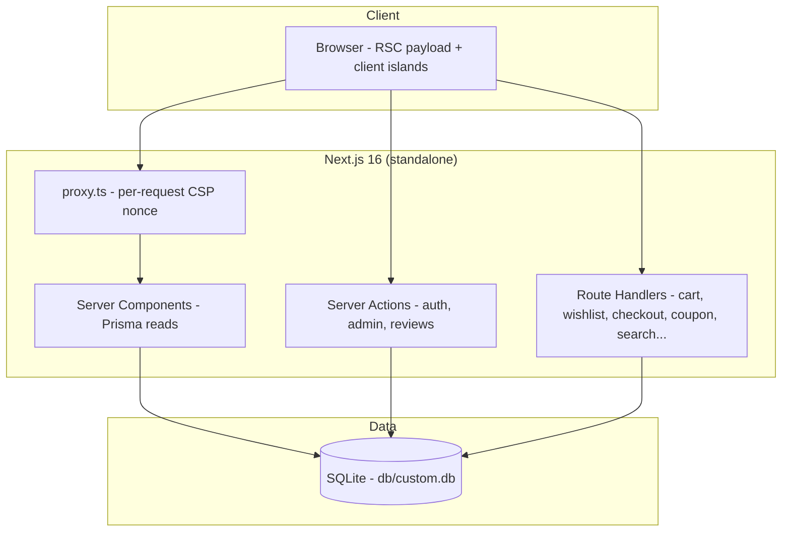

# ElyBeauty

        

A production-grade premium-skincare e-commerce storefront + admin back office — a visual-and-functional **superset** of the Base44 reference app at [`ely-beauty.base44.app`](https://ely-beauty.base44.app/). High-fashion editorial design (Cormorant Garamond + Inter, warm ivory + taupe, sharp corners), a Bangladesh-market commerce model (৳ BDT, city-tiered shipping, Cash on Delivery), **product variants (colors/sizes)**, and a full admin console, on Next.js 16 · React 19 · TypeScript strict · Tailwind CSS v4 · Prisma 6 + SQLite. Re-skinned in run-72 from the battle-tested HomeNest Kitchen scaffold (70+ remediation sessions; see `docs/reference-investigation.md` for the live-reference dossier).

## Quick Start

```bash
# 1. Install (Node ≥ 20; npm ≥ 10)
npm install

# 2. Create .env (or copy from the example)
cp .env.example .env      # DATABASE_URL="file:../db/custom.db" is the documented default

# 3. Create the schema + seed the catalog (idempotent)
npm run db:setup

# 4. Run
npm run dev               # http://localhost:3000
```

**Verify setup:** `curl localhost:3000/api/health` → `{"status":"ok","db":"up",...}`, and the home page renders the editorial hero ("The Art of Radiance") with the seeded 19-product catalog.

Demo accounts (seeded):

| Role | Email | Password |
|---|---|---|
| Admin | `admin@elybeauty.com` | `Admin123!` |
| Customer | `demo@elybeauty.com` | `Demo1234!` |

## Features

| Area | Highlights |
|---|---|
| **Storefront** | Editorial single-image hero (the carousel engine activates with 2+ slides — admin-managed) · "Shop by Ritual" image category tiles · "Curated for You" newest-6 grid · **default catalog order matches the reference's authored order** (backdated `createdAt`) · `/shop` listing with sharp category filter pills (the reference's 0-radius geometry) + native sort select (Newest / Price / Name) + search (`/products` 301-redirects) · product detail with gallery, **COLOR swatch / SIZE variant selectors**, DESCRIPTION / HOW TO USE / INGREDIENTS sections, and "Complete the Ritual" related pieces · floating WhatsApp chat (settings-driven) |
| **Commerce** | Guest carts (token-cookie, merged on login **and at sign-in**) · "Your Bag" mini drawer + full cart page · **server-computed cart badge survives full reloads** · coupons (`WELCOME10`, `SAVE20`, `FREESHIP`) with expiry + **atomic redemption caps** · first-class `free_shipping` coupon type · free-shipping threshold hint (coupon-aware) · **product variants carried end-to-end** (cart line identity → checkout summary → order snapshot) · **city-tiered shipping** (Dhaka ৳70 / outside ৳130, derived from the City field; "Enter city to calculate" before input) · single-page checkout (CONTACT → SHIPPING ADDRESS → PAYMENT METHOD → Order Notes + live ORDER SUMMARY) · **Cash on Delivery** (the reference's method; **real Stripe card payments when configured AND the `STRIPE_BDT_PER_USD` rate is set** — Payment Element (PCI SAQ-A), server-minted PaymentIntent converted through the explicit FX seam, webhook-driven placement, the admin refund ledger) · **idempotent order placement** (retries reuse the same key — no double orders) · server-side total re-derivation **inside the order transaction** + atomic stock checks · transactional cart adds (no lost increments, shared 99/stock clamp, scoped race-safe line writes) · **bounded wishlist** (100-item cap enforced transactionally) with **one-request Add All to Cart** and **server-rendered filled hearts** on the detail page |
| **Orders** | **`ELY-XXXXXXXX` crypto-random order numbers** (no sequence to enumerate) · **token-gated order-success receipt** · order tracking gated by **number + purchase email** (anti-enumeration, rate-limited) with a 4-step status timeline · per-order event history · admin cancellation restores stock · optional order notes |
| **Accounts** | Register/login (scrypt hashes, DB-backed sessions, HMAC-signed cookie) · profile editing · address book (bounded at 20, first address auto-defaults, delete-default auto-promotes, friendly 409 at the cap inside the write transaction) · **order history first** (the reference's account anatomy) |
| **Admin** (`/admin`, role-gated) | Dashboard (KPIs + 14-day revenue chart folded from bounded SQL day buckets) · products CRUD (+ colors/sizes editors, S73-12) · categories CRUD · coupons CRUD · carousel manager · orders manager (guarded transactional status transitions + carrier tracking) · analytics · store settings (incl. the Dhaka/outside shipping tiers + WhatsApp number) |
| **Content** | About ("Beauty, Redefined"), Contact (working form), 5 legal pages, 404 · SEO metadata, `sitemap.xml` (public routes only, `/shop`), `robots.txt`, **noindex on every private surface** · **schema.org JSON-LD** (Product blocks with BDT pricing, Organization + WebSite with SearchAction) · canonical URLs · OpenGraph/Twitter share cards · web manifest + favicon · branded error boundaries |

## Architecture

| Layer | Technology | Version | Purpose |
|---|---|---|---|
| Framework | Next.js (App Router, standalone) | ^16.1 | RSC rendering, Server Actions, route handlers |
| UI runtime | React | ^19 | Server Components + client islands |
| Language | TypeScript (strict) | ^5 | `noUncheckedIndexedAccess`, no `any` |
| Styling | Tailwind CSS (CSS-first `@theme`) | ^4 | Design tokens pinned to the live reference |
| Data | Prisma + SQLite | ^6.11 | 18 models; integer-cent (poisha) money |
| UI primitives | Radix UI + CVA + lucide-react | latest | Accessible dialogs, selects, sheets, toasts |
| Charts | Recharts | ^3 | Admin revenue/analytics |
| Validation | Zod | ^3.25 | Every external input boundary |
| Tests | Vitest · Playwright | ^3.2 · ^1.64 | 550 unit · 70 e2e |



### DATABASE_URL contract

`.env` carries `DATABASE_URL="file:../db/custom.db"` with `db/` at the repo root (git-ignored). Relative `file:` URLs resolve against `prisma/schema.prisma` — for the CLI **and** at runtime via `src/lib/db-path.ts` — so push, seed, dev, build and the standalone server all open the same file regardless of working directory. Pinned by `tests/unit/db-path.test.ts`.

## File Hierarchy

```
📂 src/
├── 📂 app/
│   ├── 📂 (storefront)/        # public site + admin (layout = header/footer chrome)
│   │   ├── page.tsx            # home: hero, Shop by Ritual, Curated for You, ritual banner
│   │   ├── 📂 shop/ 📂 product/[id]/   # listing (+ pill filters) + detail (+ variants)
│   │   ├── 📂 cart/ 📂 checkout/ 📂 track-order/ 📂 wishlist/ 📂 account/
│   │   ├── 📂 about/ 📂 contact/ 📂 legal/[slug]/
│   │   └── 📂 admin/           # dashboard, products, orders, categories,
│   │                           # coupons, carousel, analytics, settings (role-gated)
│   ├── 📂 (auth)/              # login, register (per-request render for CSP nonces)
│   ├── 📂 api/                 # cart (+bulk), cart-summary, wishlist, checkout,
│   │                           # coupon/apply, addresses, contact, newsletter,
│   │                           # search, health, stripe/*
│   ├── layout.tsx              # fonts (Cormorant Garamond + Inter), StoreProvider + Toaster
│   ├── globals.css             # Tailwind v4 @theme tokens pinned to the reference
│   └── not-found.tsx / robots.ts / sitemap.ts
├── 📂 components/ (store/, ui/, checkout/) # header, mobile-nav, footer, product-card,
│   │                                       # whatsapp-float, drawer, stripe-pay...
├── 📂 lib/                      # db, db-path, auth, cart (+variants), wishlist, money (৳),
│   │                            # order-money (+shippingMethodForCity), order-number (ELY-),
│   │                            # coupons, settings, products, validation, csp, seo
└── 📂 actions/                  # server actions: auth, admin, reviews
📂 prisma/                       # schema.prisma (18 models) + seed.ts (idempotent)
📂 tests/                        # unit/ (Vitest · 550) · e2e/ (Playwright · 70)
📂 db/                           # custom.db (created by db:push, git-ignored)
📂 docs/                         # reference dossier, implementation plan, screenshots/
```

## Environment Variables

| Variable | Default | Purpose |
|---|---|---|
| `DATABASE_URL` | `file:../db/custom.db` | SQLite file; relative URLs resolve against `prisma/schema.prisma` |
| `NEXT_PUBLIC_SITE_URL` | `http://localhost:3000` | Canonical origin for metadata/sitemap/robots |
| `AUTH_SECRET` | dev-only fallback | **Set in production** — HMAC key for session cookies (`openssl rand -hex 32`) |
| `NEXT_PUBLIC_DEMO_MODE` | production: hidden · dev: shown | The login page's demo-credentials quick-fill; production builds hide it by default **and ship no credential strings at all** |
| `TRUST_CF_CONNECTING_IP` | `"true"` (trust) | Set `"false"` on direct deployments so the client-forgeable `cf-connecting-ip` header can't rotate rate-limit buckets |
| `STRIPE_SECRET_KEY` / `NEXT_PUBLIC_STRIPE_PUBLISHABLE_KEY` / `STRIPE_WEBHOOK_SECRET` | empty | Stripe keys for the Card option (default: Cash on Delivery only — byte-identical) |
| `STRIPE_BDT_PER_USD` | unset | **Required with the keys** to enable Card: the taka-per-dollar rate the PaymentIntent converts through (Stripe cannot charge BDT; without it Card stays off — a ~120× overcharge guard) |

## Testing

```bash
npm run test            # 550 unit tests (Vitest, node env; the component tests run under jsdom)
npm run typecheck:tests # the unit/e2e/seed sources are type-checked too
npm run build           # required before e2e (suite starts the standalone server)
npm run test:e2e        # 70 e2e tests (Playwright; server auto-started on :3100)
npx playwright test tests/e2e/mobile-navigation.spec.ts   # single spec
```

- **Unit** covers the ৳ money math, the Stripe FX seam (`stripeChargeAmount` + the rate-gated config truth table + the converted in-tx amount guard) (whole-taka + poisha rendering), the `DATABASE_URL` resolution contract, coupon rules and lifecycle gates, scrypt hashing, Zod schemas (root-relative image URLs, price bounds, bulk cart with variants, the BD address model, admin variant editors), order-total derivation **and the city-tier shipping mapping — derived IN-TX from the address city (S73-1, integration-pinned)**, the **variant-label composition** (`composeVariantLabel`, S73-7), the **composite-key merge stock clamp** (`stockMapForCompositeKeys`, S73-2), the **ELY- order-number format**, the variant-aware cart planners (merge + bulk composite keys), the CSP builder, rate limiting + `clientIp`, auth/tracking/order-status/order-access gates, review-aggregate transactional growth, sitemap/robots privacy, JSON-LD builders, the seed policy, and the ElyBeauty catalog constants (19 products / authored order / categories / variants).
- **E2E** covers the reference anatomy (home/shop/detail/footer), the full guest COD checkout → `ELY-XXXXXXXX` → tracking loop **including the token-gated receipt and guess-denial**, an idempotent checkout replay, the guest-cart merge at login, the **variant carry-through** (select → bag → summary → receipt), the **shipping tiers** (Dhaka ৳70 / outside ৳130 / FREESHIP → FREE), auth success/failure, admin gating, the address-book lifecycle, reviews, wishlist flows, the cart badge freshness, the SEO/platform contracts (JSON-LD with BDT, robots/sitemap, security headers, noindex), the Stripe-configured surfaces' guards, and — most importantly — `mobile-navigation.spec.ts`, the **Tailwind v4 regression guard** for the mobile menu (conditional mount, no-JS-toggled `hidden`, toggle-closes, scroll lock, the in-panel search flow, route-change close on the iPhone-13 viewport).
- E2E specs wait for hydration (`gotoHydrated`) before interacting; clicking before hydration falls back to native form GET, which is exactly the class of bug the guard exists for.

## Design System

| Token | Value | Usage |
|---|---|---|
| `background` | `hsl(30 20% 97%)` | Warm ivory page background |
| `primary` | `hsl(30 12% 48%)` | Warm taupe — buttons, active states |
| `foreground` | `hsl(0 0% 10%)` | Body text |
| `muted-foreground` | `hsl(0 0% 40%)` | Secondary text, compare-at prices |
| `border` / `input` | `hsl(30 10% 88%)` | Hairlines, inputs |
| `destructive` | `hsl(0 84.2% 60.2%)` | SALE badge, errors |
| `radius` | `0.25rem` (4px) | Sharp editorial corners |

Typography: **Cormorant Garamond** (300–600) for display headings via `.font-display` (light weight, tight tracking), **Inter** (300–600) for body — both via `next/font`. Micro-labels: `.eyebrow-label` (12px/500, 0.1em tracking, uppercase — S73-6, measured on the reference); text CTAs: `.link-cta` (underlined). Tailwind v4 CSS-first config in `src/app/globals.css` (`@theme inline`; no `tailwind.config.js`).

## Screenshots

Captured from the running production build — see `docs/screenshots/`:

`01-home` … `11-checkout` (incl. `04b-cart-coupon-hint`) · `12-admin-dashboard` … `18-admin-settings` (incl. `15b-admin-coupons`) · `19-account` · `20-mobile-home` · `21-mobile-menu-open` · `22-tracking-locked` · `23-checkout-success-locked` — regenerate with `node scripts/capture-screenshots.mjs` (server on :3000)

## Troubleshooting

| Symptom | Cause | Fix |
|---|---|---|
| `db/custom.db` appears elsewhere / stale rows survive reseed | `DATABASE_URL` shadowed by the process env | Check `node -e "console.log(process.env.DATABASE_URL)"`; converge or unset |
| Page paints but never hydrates (no console errors) | Static prerender + per-request CSP nonce mismatch | Make the route render per-request (`await connection()` — see `(auth)/layout.tsx`) |
| Mobile menu broken after a refactor | Tailwind v4 display-utility toggling | Restore the mount/transform pattern; run the mobile-navigation e2e spec |
| `EADDRINUSE :3100` during e2e | A previous standalone server is alive (process renames to `next-server`) | `pkill -f next-server` |
| Stock-assuming e2e pins fail after many sessions | E2E checkouts permanently drain the traffic-owned demo stock | `npx tsx scripts/restore-demo-stock.ts` (also runs automatically on a fresh e2e server start) |
| npm blocks install scripts | npm's script-approval gate | `npm install-scripts approve @prisma/engines esbuild unrs-resolver` |

## License

MIT — see the repository settings. Reference app © its respective owners; this implementation shares no code with it, and all imagery is independently generated.
